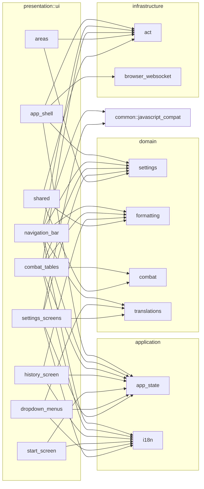
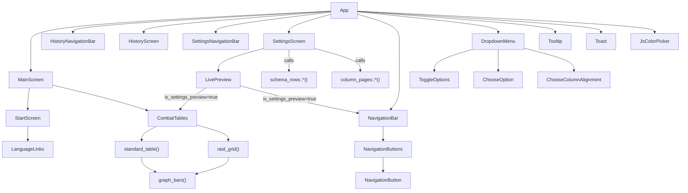
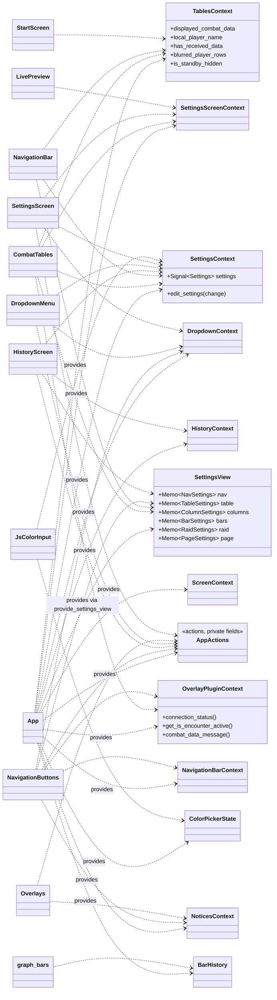
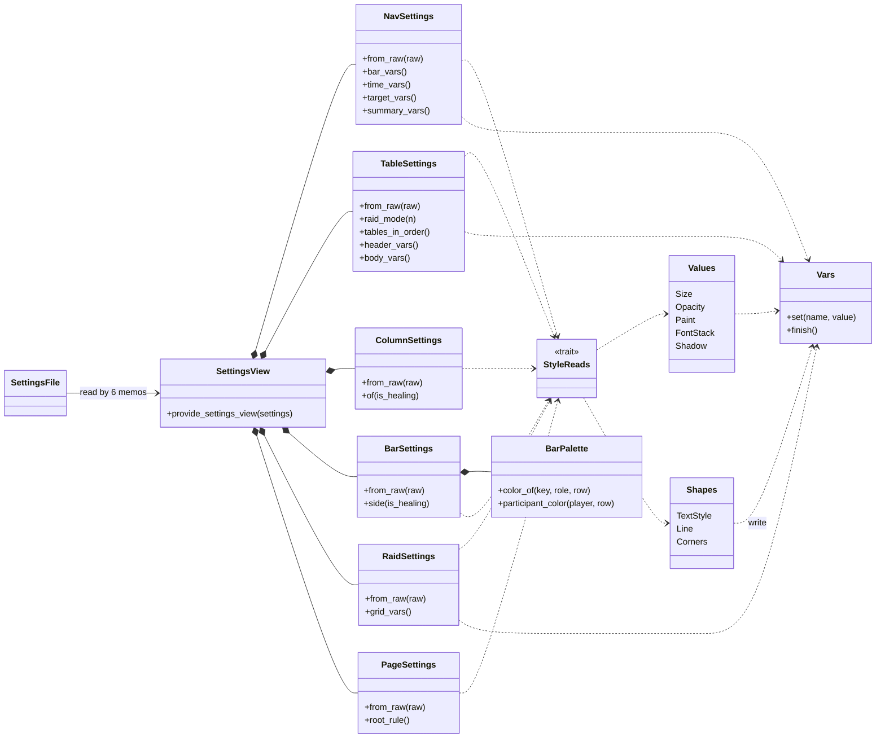
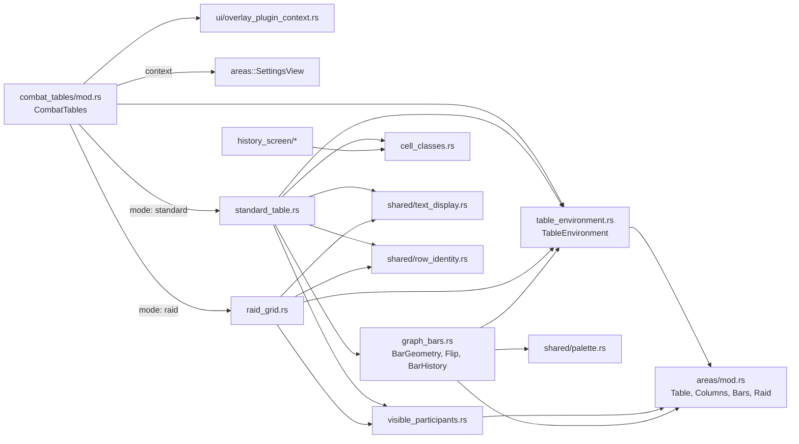
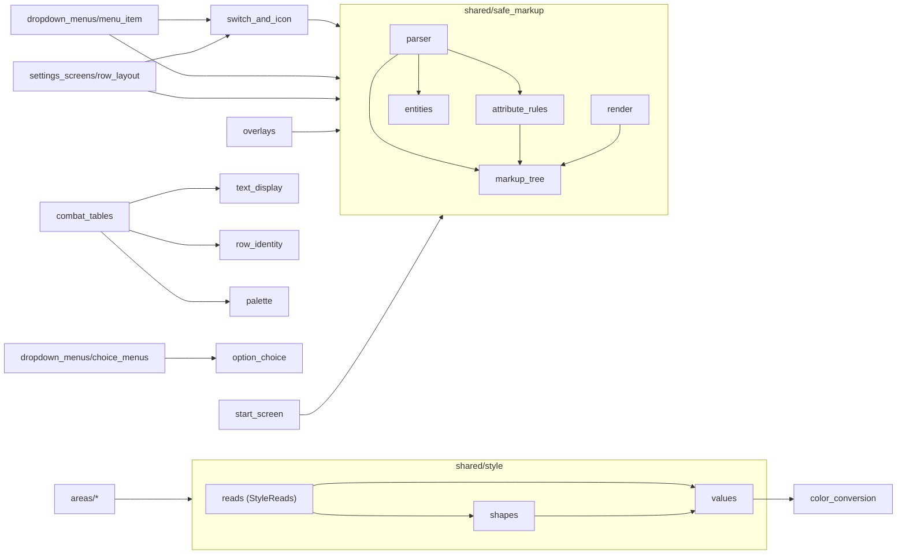
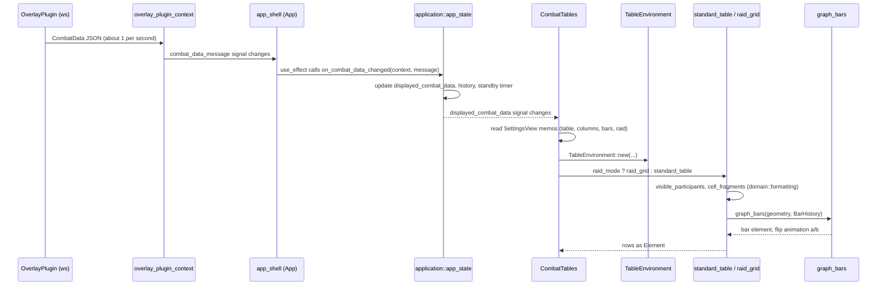
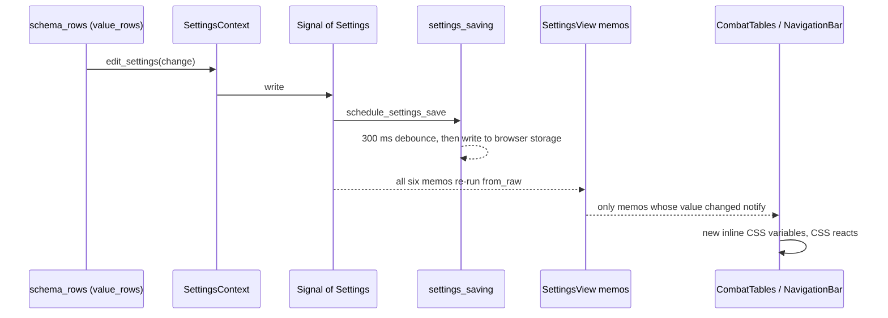

# Presentation map

UML views of the 74 files under `src/presentation`, drawn from their real `use` statements, context calls and components. Diagrams are Mermaid, so GitHub renders them inline (also in comments).

## 1. Package dependencies

What each folder under `ui/` reaches outside presentation. Arrows point from the user to the used package. Only folders that have an outside dependency are connected.

## 2. Component render tree

`App` picks the top bar and the body from `ScreenContext.current_screen` (Main, History or Settings). The same two components, `CombatTables` and `NavigationBar`, are reused by the main screen and by the settings live preview.

Lower-case names are plain functions that return `Element`, not components. `PageContent` is an enum that picks which settings page function to call. `history_screen` imports only `capture_screenshot` from `navigation_bar`.

## 3. Shared state and who reads it

`App` creates and provides these values with `use_context_provider`: one context per section of the page, `AppActions`, the settings view, the connection, the colour picker and the bar history. Everything below reads them with `use_context`.

`graph_bars` reaches `BarHistory` through a consume call, not a hook, because it runs once per row.

## 4. Settings to style pipeline

The refactor's core path: the raw settings file becomes six typed area structs, each of which turns itself into inline CSS variables through the shared style types.

## 5. combat_tables, file by file

How `CombatTables` builds a table. `TableEnvironment` bundles the area structs and the cell context so the drawing functions take one argument.

## 6. settings_screens, file by file

Pages are driven by data (`data/l.json`), so `schema_rows` has one file per row kind. Almost everything depends on `row_context` and `row_layout`.

```mermaid
flowchart TD
  subgraph SR["schema_rows"]
    srmod["mod.rs"]
    choice["choice_rows"]
    link["link_and_action_rows"]
    text["text_rows"]
    value["value_rows"]
  end
  subgraph CP["column_pages"]
    cpmod["mod.rs"]
    titles["column_titles"]
    order["column_order_page"]
    size["column_size_page"]
    align["column_alignment_page"]
    header["header_text_page"]
    abbr["abbreviation_list"]
  end
  rowgroups["row_groups"] --> pagecontent["page_content"]
  rowgroups --> srmod
  rowgroups --> rowctx["row_context"]
  tabbar["tab_bar"] --> pagecontent
  tabbar --> rowctx
  srmod --> pagecontent
  srmod --> rowctx
  choice --> srmod
  choice --> rowlayout["row_layout"]
  choice --> rowctx
  link --> srmod
  link --> rowlayout
  text --> srmod
  text --> formactions["form_actions"]
  text --> textbox["text_box"]
  value --> srmod
  value --> jscolor["js_color"]
  value --> slider["slider_row"]
  value --> rowlayout
  slider --> rowlayout
  formactions --> b64["base64_encoding"]
  formactions --> textbox
  textbox --> rowctx
  align --> titles
  size --> titles
  size --> slider
  header --> titles
  header --> formactions
  header --> textbox
  header --> rowlayout
  abbr --> rowlayout
  cpmod --> rowctx
  rowlayout --> shared["shared: safe_markup, switch_and_icon"]
  livepreview["live_preview"] --> tables["combat_tables"]
  livepreview --> navbar["navigation_bar"]
```

## 7. shared

Leaf helpers. `style` is used only by `areas`; `safe_markup` turns the translated HTML snippets into Dioxus elements.

## 8. A data update, end to end

ACT sends a message; the table redraws. Only the memos and signals that changed cause work.

## 9. Editing a setting

A slider or colour change on a settings page. Because each area is its own memo, only the areas whose values changed re-render their consumers.

## Findings

- **No cycles between folders.** The dependency direction is `app_shell` to screens to `combat_tables`/`navigation_bar` to `areas` to `shared/style`.
- **Cross-screen reuse is small and one-way.** `settings_screens` uses `combat_tables` and `navigation_bar`; `history_screen` uses `navigation_bar` and `combat_tables::cell_classes`; `start_screen` uses `combat_tables`. Nothing imports a screen back.
- **`areas` and `shared/style` are pure.** They depend only on `domain::settings` (and one `infrastructure::act` type), never on Dioxus components or the application contexts.
- **Heaviest fan-in:** `row_context` (16 settings files), `safe_markup` (9 files) and `areas/mod.rs` (7 files).
- **Method.** Edges come from `use` statements resolved to files. Paths written inline, such as `use_context::<areas::SettingsView>()`, are added by hand from a grep of the context calls.
