# Presentation layer — detailed UML report

*Generated from the source at commit `73c6aaa+` by `docs/uml/tools/extract.py` and `generate.py`. Every table and edge below comes from the code (doc comments, signatures, `use` paths, call sites); the descriptions are the code's own doc comments. Regenerate: `REPO=. python3 docs/uml/tools/extract.py && python3 docs/uml/tools/generate.py docs/uml/presentation-detailed.md $(git rev-parse --short HEAD)` (run from a scratch folder; `extract.py` writes `facts.json` in the current directory).*

The presentation layer is `src/presentation/ui` — **74 files, 492 items**. It draws the screens, reads the state that `application` owns, and never talks to ACT or the browser except through `application` and `infrastructure`.

## Contents

1. [How to read the diagrams](#1-how-to-read-the-diagrams)
2. [The layers](#2-the-layers)
3. [Runtime flows](#3-runtime-flows) — start-up, data to screen, one table, settings edit, standby
4. [Shared state and contexts](#4-shared-state-and-contexts)
5. [Component render tree](#5-component-render-tree)
6. [Package by package](#6-package-by-package) — each with a diagram and a table of what every file does, produces and calls

## 1. How to read the diagrams

| Notation | Meaning |
|---|---|
| class box | one source file (`foo/bar.rs`); its participants are its public functions, components (`«C»`) and types |
| `A ..> B : x, y` | code in A calls / uses `x`, `y` defined in B |
| `A *--> B : renders X` | the component A draws component X (defined in B) in its `rsx!` |
| `<<application>>`, `<<domain>>`, `<<infrastructure>>` | a file outside the presentation layer |
| **Produces** (tables) | what the item returns: `DOM` is a Dioxus `Element`; CSS variables and class lists are `String`s; *side effect* means it writes signals or the DOM instead of returning a value |

## 2. The layers

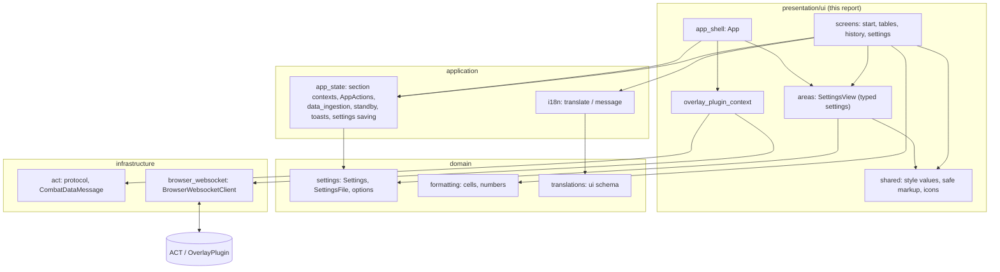

**Rule of thumb.** Components read state (their section's context, `OverlayPluginContext`, `SettingsView`) and call `application` functions to change it; `domain` decides what numbers and settings mean; `infrastructure` is the only side that touches the network.

## 3. Runtime flows

### 3.1 Start-up

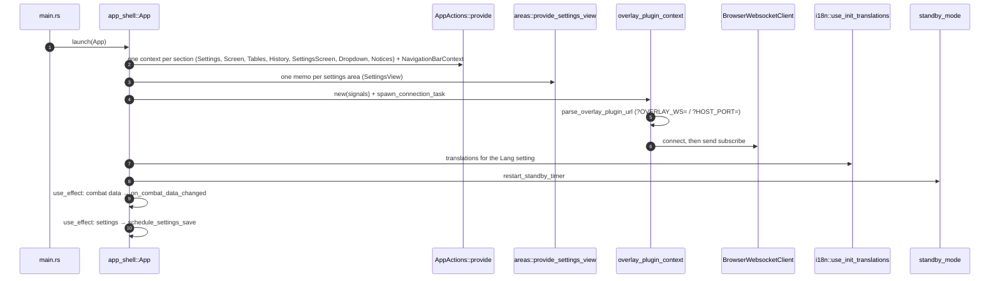

### 3.2 From an ACT message to the table on screen

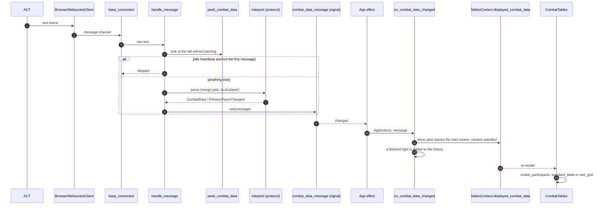

### 3.3 Drawing one table

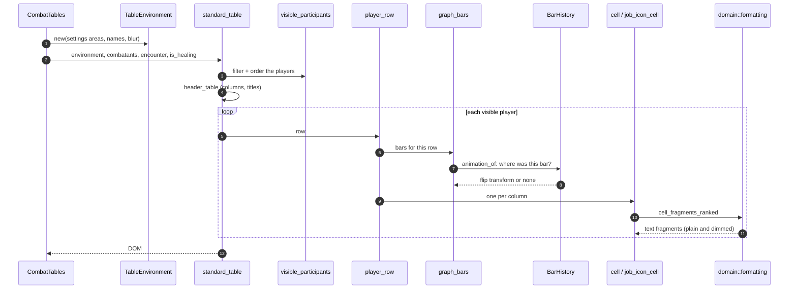

### 3.4 Changing a setting

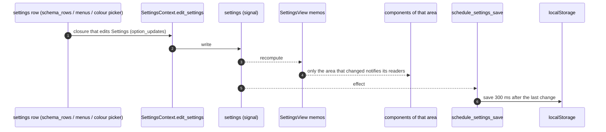

### 3.5 Standby (hiding the tables after a quiet time)

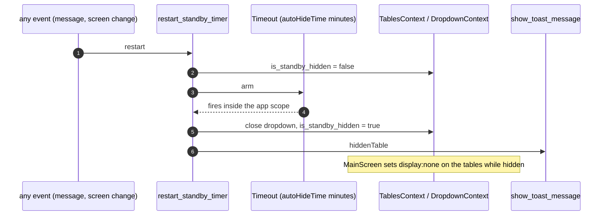

## 4. Shared state and contexts

Provided once by `App`; every component reaches them with `use_context`. The application state is split **one context per section of the page**: a component reads only its own section's context. `AppActions` is what starts an action that changes several sections; its fields are private, so it cannot be used to read state.

| Context | Defined in | Holds | Read by (files) |
|---|---|---|---|
| `SettingsContext` | `application/app_state/contexts/settings_context.rs` | the user's settings and `edit_settings()` (every section) | `app_shell`, `combat_tables/mod`, `dropdown_menus/mod`, `history_screen/mod`, `navigation_bar/mod`, `page_services`, `settings_screens/js_color`, `settings_screens/mod`, `start_screen/language_links` |
| `ScreenContext` | `application/app_state/contexts/screen_context.rs` | which full screen is shown (`Screen`) | `app_shell`, `dropdown_menus/mod`, `page_services` |
| `TablesContext` | `application/app_state/contexts/tables_context.rs` | tables section: displayed combat data, local player, first-data flag, standby flag, blurred rows | `combat_tables/mod`, `combat_tables/standard_table`, `navigation_bar/mod`, `overlay_plugin_context`, `start_screen/mod` |
| `HistoryContext` | `application/app_state/contexts/history_context.rs` | History screen: finished encounters, zone counter, viewed entry | `history_screen/mod` |
| `SettingsScreenContext` | `application/app_state/contexts/settings_screen_context.rs` | settings screens: open page and tab (`SettingsLocation`), sample tables on/off, raid-mode sample | `combat_tables/mod`, `dropdown_menus/mod`, `page_services`, `settings_screens/live_preview`, `settings_screens/mod`, `settings_screens/navigation_bar` |
| `NavigationBarContext` | `application/app_state/contexts/navigation_bar_context.rs` | top bar: buttons expanded, capture icon flashing | `history_screen/mod`, `navigation_bar/buttons` |
| `DropdownContext` | `application/app_state/contexts/dropdown_context.rs` | the open pop-up menu (`Dropdown`) | `app_shell`, `dropdown_menus/mod`, `navigation_bar/buttons`, `settings_screens/mod`, `settings_screens/navigation_bar` |
| `NoticesContext` | `application/app_state/contexts/notices_context.rs` | floating messages: toast state, toast generation, tooltip | `navigation_bar/buttons`, `overlays`, `page_services` |
| `AppActions` | `application/app_state/app_actions.rs` | actions that change several sections (open settings, new fight, standby, backup); holds the contexts privately, so nothing can be read through it | `dropdown_menus/mod`, `history_screen/mod`, `navigation_bar/buttons`, `overlay_plugin_context`, `overlays`, `page_services`, `settings_screens/mod`, `settings_screens/navigation_bar`, `start_screen/language_links` |
| `OverlayPluginContext` | `overlay_plugin_context.rs` | connection status, the last combat data message, the local player, errors | `combat_tables/mod`, `navigation_bar/buttons` |
| `SettingsView` | `areas/mod.rs` | one memo per settings area: bars, columns, nav, page, raid, table | `app_shell`, `combat_tables/mod`, `history_screen/mod`, `navigation_bar/buttons`, `navigation_bar/mod`, `overlay_plugin_context`, `page_services` |
| `BarHistory` | `combat_tables/graph_bars.rs` | where each graph bar was last drawn, so a change can be animated | `combat_tables/mod` |
| `ColorPickerState` | `settings_screens/js_color.rs` | what the one shared colour picker panel is doing | `app_shell` |
| `I18n` | `application/i18n.rs` | the Fluent translations for the current language | (read through application functions) |

## 5. Component render tree

Which component draws which (from the `rsx!` of every component).

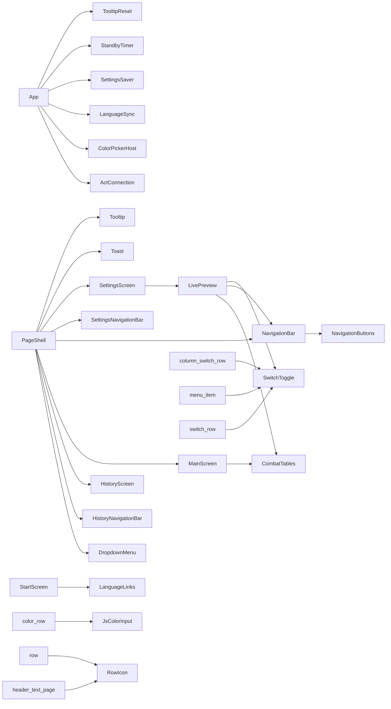

Components with no parent here are drawn from `App` or from a `match` on the current screen (`Screen::Main` → `NavigationBar` + `MainScreen`; `Screen::History` → `HistoryNavigationBar` + `HistoryScreen`; `Screen::Settings` → `SettingsNavigationBar` + `SettingsScreen`).

## 6. Package by package

### 6.1 `(root)`

The root component and the one connection to ACT.

```mermaid
classDiagram
  direction LR
  class app_shell["app_shell"]
  app_shell : +App() «C»
  app_shell : +PageShell() «C»
  class overlay_plugin_context["overlay_plugin_context"]
  overlay_plugin_context : +enum ConnectionStatus
  overlay_plugin_context : +struct StartError
  overlay_plugin_context : +struct OverlayPluginContext
  overlay_plugin_context : +new()
  overlay_plugin_context : +connection_status()
  overlay_plugin_context : +error_message()
  overlay_plugin_context : +get_is_encounter_active()
  class overlays["overlays"]
  overlays : +Tooltip() «C»
  overlays : +Toast() «C»
  class page_services["page_services"]
  page_services : +LanguageSync() «C»
  page_services : +SettingsSaver() «C»
  page_services : +StandbyTimer() «C»
  page_services : +TooltipReset() «C»
  class x_application_app_state_app_actions["application/app_state/app_actions"]
  <<application>> x_application_app_state_app_actions
  class x_application_app_state_contexts_dropdown_context["application/app_state/contexts/dropdown_context"]
  <<application>> x_application_app_state_contexts_dropdown_context
  class x_application_app_state_contexts_navigation_bar_context["application/app_state/contexts/navigation_bar_context"]
  <<application>> x_application_app_state_contexts_navigation_bar_context
  class x_application_app_state_contexts_screen_context["application/app_state/contexts/screen_context"]
  <<application>> x_application_app_state_contexts_screen_context
  class x_application_app_state_contexts_settings_context["application/app_state/contexts/settings_context"]
  <<application>> x_application_app_state_contexts_settings_context
  class x_application_i18n["application/i18n"]
  <<application>> x_application_i18n
  class x_areas_mod["areas/mod"]
  <<presentation>> x_areas_mod
  class x_areas_page["areas/page"]
  <<presentation>> x_areas_page
  class x_combat_tables_graph_bars["combat_tables/graph_bars"]
  <<presentation>> x_combat_tables_graph_bars
  class x_dropdown_menus_mod["dropdown_menus/mod"]
  <<presentation>> x_dropdown_menus_mod
  class x_history_screen_mod["history_screen/mod"]
  <<presentation>> x_history_screen_mod
  class x_navigation_bar_mod["navigation_bar/mod"]
  <<presentation>> x_navigation_bar_mod
  class x_settings_screens_js_color["settings_screens/js_color"]
  <<presentation>> x_settings_screens_js_color
  class x_settings_screens_mod["settings_screens/mod"]
  <<presentation>> x_settings_screens_mod
  class x_settings_screens_navigation_bar["settings_screens/navigation_bar"]
  <<presentation>> x_settings_screens_navigation_bar
  class x_start_screen_mod["start_screen/mod"]
  <<presentation>> x_start_screen_mod
  class x_application_app_state_contexts_tables_context["application/app_state/contexts/tables_context"]
  <<application>> x_application_app_state_contexts_tables_context
  class x_application_app_state_data_ingestion["application/app_state/data_ingestion"]
  <<application>> x_application_app_state_data_ingestion
  class x_infrastructure_act_data_combat_data_message["infrastructure/act/data/combat_data_message"]
  <<infrastructure>> x_infrastructure_act_data_combat_data_message
  class x_infrastructure_act_data_combat_data_peek["infrastructure/act/data/combat_data_peek"]
  <<infrastructure>> x_infrastructure_act_data_combat_data_peek
  class x_infrastructure_act_data_overlay_message["infrastructure/act/data/overlay_message"]
  <<infrastructure>> x_infrastructure_act_data_overlay_message
  class x_infrastructure_act_overlay_plugin_protocol["infrastructure/act/overlay_plugin_protocol"]
  <<infrastructure>> x_infrastructure_act_overlay_plugin_protocol
  class x_infrastructure_browser_websocket_browser_websocket_client["infrastructure/browser_websocket/browser_websocket_client"]
  <<infrastructure>> x_infrastructure_browser_websocket_browser_websocket_client
  class x_infrastructure_browser_websocket_mod["infrastructure/browser_websocket/mod"]
  <<infrastructure>> x_infrastructure_browser_websocket_mod
  class x_application_app_state_contexts_notices_context["application/app_state/contexts/notices_context"]
  <<application>> x_application_app_state_contexts_notices_context
  class x_application_app_state_toast_notifications["application/app_state/toast_notifications"]
  <<application>> x_application_app_state_toast_notifications
  class x_shared_safe_markup_mod["shared/safe_markup/mod"]
  <<presentation>> x_shared_safe_markup_mod
  class x_application_app_state_contexts_settings_screen_context["application/app_state/contexts/settings_screen_context"]
  <<application>> x_application_app_state_contexts_settings_screen_context
  class x_application_app_state_settings_saving["application/app_state/settings_saving"]
  <<application>> x_application_app_state_settings_saving
  class x_application_app_state_standby_mode["application/app_state/standby_mode"]
  <<application>> x_application_app_state_standby_mode
  app_shell ..> x_application_app_state_app_actions : AppActions
  app_shell ..> x_application_app_state_contexts_dropdown_context : DropdownContext, context DropdownContext
  app_shell ..> x_application_app_state_contexts_navigation_bar_context : NavigationBarContext
  app_shell ..> x_application_app_state_contexts_screen_context : Screen, ScreenContext, context ScreenContext
  app_shell ..> x_application_app_state_contexts_settings_context : SettingsContext, context SettingsContext
  app_shell ..> x_application_i18n : use_init_translations
  app_shell ..> x_areas_mod : SettingsView, context SettingsView, provide_settings_view
  app_shell ..> x_areas_page : .root_rule(), SettingsView.page
  app_shell ..> x_combat_tables_graph_bars : BarHistory
  app_shell ..> x_dropdown_menus_mod : renders DropdownMenu
  app_shell ..> x_history_screen_mod : renders HistoryNavigationBar, HistoryScreen
  app_shell ..> x_navigation_bar_mod : renders NavigationBar
  app_shell *--> overlay_plugin_context : renders ActConnection
  app_shell *--> overlays : renders Toast, Tooltip
  app_shell *--> page_services : renders LanguageSync, SettingsSaver, StandbyTimer, TooltipReset
  app_shell ..> x_settings_screens_js_color : renders ColorPickerHost
  app_shell ..> x_settings_screens_mod : renders SettingsScreen
  app_shell ..> x_settings_screens_navigation_bar : renders SettingsNavigationBar
  app_shell ..> x_start_screen_mod : renders MainScreen
  overlay_plugin_context ..> x_application_app_state_app_actions : AppActions, context AppActions
  overlay_plugin_context ..> x_application_app_state_contexts_tables_context : TablesContext, context TablesContext
  overlay_plugin_context ..> x_application_app_state_data_ingestion : on_combat_data_changed
  overlay_plugin_context ..> x_infrastructure_act_data_combat_data_message : CombatDataMessage
  overlay_plugin_context ..> x_infrastructure_act_data_combat_data_peek : peek_combat_data
  overlay_plugin_context ..> x_infrastructure_act_data_overlay_message : ParseOptions
  overlay_plugin_context ..> x_infrastructure_act_overlay_plugin_protocol : .websocket_url(), OverlayPluginEvent, OverlayPluginUrl 
  overlay_plugin_context ..> x_infrastructure_browser_websocket_browser_websocket_client : BrowserWebsocketClient
  overlay_plugin_context ..> x_infrastructure_browser_websocket_mod : MissingHost
  overlay_plugin_context ..> x_areas_mod : SettingsView, context SettingsView
  overlay_plugin_context ..> x_areas_page : SettingsView.page
  overlays ..> x_application_app_state_app_actions : AppActions, context AppActions
  overlays ..> x_application_app_state_contexts_notices_context : NoticesContext, context NoticesContext
  overlays ..> x_application_app_state_toast_notifications : dismiss_toast_message
  overlays ..> x_shared_safe_markup_mod : markup_view
  page_services ..> x_application_app_state_app_actions : AppActions, context AppActions
  page_services ..> x_application_app_state_contexts_notices_context : NoticesContext, context NoticesContext
  page_services ..> x_application_app_state_contexts_screen_context : ScreenContext, context ScreenContext
  page_services ..> x_application_app_state_contexts_settings_context : SettingsContext, context SettingsContext
  page_services ..> x_application_app_state_contexts_settings_screen_context : SettingsScreenContext, context SettingsScreenContext
  page_services ..> x_application_app_state_settings_saving : register_save_on_page_hide, schedule_settings_save
  page_services ..> x_application_app_state_standby_mode : restart_standby_timer
  page_services ..> x_application_i18n : language_tag
  page_services ..> x_areas_mod : SettingsView, context SettingsView
  page_services ..> x_areas_page : SettingsView.page
```

#### `app_shell`  (145 lines)

Root component: builds the state the sections share, and the page shell around the current screen.

| Item | Kind | What it does | Produces | Calls / uses |
|---|---|---|---|---|
| `asset_url` *(private)* | function | The URL of an asset. | `String` | — |
| `clock_font_face` *(private)* | function | `@font-face` rule of the clock font, with asset URLs that are right wherever the app is hosted. | `String` | `application/app_state/app_actions`: `AppActions` |
| `App` «C» | component | Root component. Builds the shared state and every context, starts the connection to ACT, wires the effects (combat data → display, settings → save, language) and draws the page shell around the current screen. | DOM (Dioxus `Element`) | **renders** `LanguageSync`, `SettingsSaver`, `StandbyTimer`, `TooltipReset`, `ActConnection`, `ColorPickerHost`; `overlay_plugin_context`: `ActConnection`; `page_services`: `LanguageSync`, `SettingsSaver`, `StandbyTimer`; `settings_screens/js_color`: `ColorPickerHost`; `application/app_state/app_actions`: `AppActions`; `application/app_state/contexts/settings_context`: `SettingsContext`; `areas/mod`: `provide_settings_view`; `application/i18n`: `use_init_translations`; … (+2) |
| `PageShell` «C» | component | The page itself: its stylesheets and page-wide variables, the open pop-up menu, the top bar and the body of the current screen. | DOM (Dioxus `Element`) | **renders** `DropdownMenu`, `NavigationBar`, `HistoryNavigationBar`, `HistoryScreen`, `SettingsNavigationBar`, `Toast`, `Tooltip`, `MainScreen`, `SettingsScreen`; `dropdown_menus/mod`: `DropdownMenu`; `history_screen/mod`: `HistoryNavigationBar`, `HistoryScreen`; `navigation_bar/mod`: `NavigationBar`; `areas/mod`: `SettingsView`; `overlays`: `Toast`, `Tooltip`; `settings_screens/js_color`: `ColorPickerState`; `settings_screens/navigation_bar`: `SettingsNavigationBar`; … (+12) |

#### `overlay_plugin_context`  (265 lines)

The one connection to `OverlayPlugin`, and everything it reports, as Dioxus context.

| Item | Kind | What it does | Produces | Calls / uses |
|---|---|---|---|---|
| `ConnectionStatus` | enum | State of the link to `OverlayPlugin`. | value type | — |
| `retry_delay_seconds` *(private)* | function | Seconds to wait after `failed_attempts` attempts in a row failed to open: 1, 1, 2, 4, 8, then 15 from then on. | `u32` | — |
| `StartError` | struct |  | value type | — |
| `OverlayPluginContext` | struct | The signals of the connection (status, last combat data, local player, error), provided as context. | value type | `infrastructure/act/data/combat_data_message`: `CombatDataMessage` |
| `new` | method |  | `OverlayPluginContext` | `infrastructure/act/data/combat_data_message`: `CombatDataMessage` |
| `connection_status` | method |  | `ConnectionStatus` | — |
| `error_message` | method |  | `Option<String>` | — |
| `get_is_encounter_active` | method |  | `bool` | — |
| `combat_data_message` | method |  | `Option<Rc<CombatDataMessage>>` | `infrastructure/act/data/combat_data_message`: `CombatDataMessage` |
| `local_player_name` | method |  | `String` | — |
| `set_merge_pets_into_owner` | method |  | — | — |
| `show_sample_data` | method |  | — | `infrastructure/act/data/combat_data_message`: `CombatDataMessage` |
| `ActConnection` «C» | component | Owns the connection to ACT for the whole page: creates the context, runs the task that keeps it open, and feeds what arrives into the page (the combat tables' data, the local player's name). | DOM (Dioxus `Element`) | `application/app_state/data_ingestion`: `on_combat_data_changed`; `application/app_state/app_actions`: `AppActions`; `application/app_state/contexts/tables_context`: `TablesContext`; `areas/mod`: `SettingsView`; `application/app_state/app_actions`: context AppActions; `areas/mod`: context SettingsView; `application/app_state/contexts/tables_context`: context TablesContext; … (+1) |
| `spawn_connection_task` *(private)* | function |  | side effect (signals / DOM events) | `infrastructure/act/data/combat_data_message`: `CombatDataMessage` |
| `keep_connected` *(private)* | function | The connection loop: connect, subscribe, feed messages to `handle_message`, and reconnect with a growing delay when the socket closes. | side effect (signals / DOM events) | `infrastructure/act/data/combat_data_message`: `CombatDataMessage`; `infrastructure/act/overlay_plugin_protocol`: `.websocket_url()`, `subscribe_message`; `infrastructure/browser_websocket/browser_websocket_client`: `BrowserWebsocketClient` |
| `handle_message` *(private)* | function | Decides what one raw ACT message means: skips idle heartbeats (never the first message), parses the rest, and sets the combat data or the local player. | side effect (signals / DOM events) | `infrastructure/act/data/combat_data_peek`: `peek_combat_data`; `infrastructure/act/data/combat_data_message`: `CombatDataMessage`; `infrastructure/act/data/overlay_message`: `ParseOptions`; `infrastructure/act/overlay_plugin_protocol`: `OverlayPluginEvent`, `interpret` |
| `parse_overlay_plugin_url` *(private)* | function | The ACT address from the page URL (`?OVERLAY_WS=` / `?HOST_PORT=`), validated. | `Result<OverlayPluginUrl, OverlayPluginUrlError>` | `infrastructure/act/overlay_plugin_protocol`: `OverlayPluginUrl`, `OverlayPluginUrlError`; `infrastructure/browser_websocket/mod`: `MissingHost` |
| `overlay_ws_from_page` *(private)* | function | Reads the query string of the page. | `Option<String>` | — |

#### `overlays`  (39 lines)

Floating messages: the hover tooltip and the sliding toast.

| Item | Kind | What it does | Produces | Calls / uses |
|---|---|---|---|---|
| `Tooltip` «C» | component | Small hover hint (column descriptions, button names). | DOM (Dioxus `Element`) | `application/app_state/contexts/notices_context`: `NoticesContext`; `shared/safe_markup/mod`: `markup_view`; `application/app_state/contexts/notices_context`: context NoticesContext |
| `Toast` «C» | component | Slide-in message ("Backup completed"). | DOM (Dioxus `Element`) | `application/app_state/toast_notifications`: `dismiss_toast_message`; `application/app_state/app_actions`: `AppActions`; `application/app_state/contexts/notices_context`: `NoticesContext`; `shared/safe_markup/mod`: `markup_view`; `application/app_state/app_actions`: context AppActions; `application/app_state/contexts/notices_context`: context NoticesContext |

#### `page_services`  (60 lines)

Jobs that run for as long as the page does, each a component of its own that draws nothing.

| Item | Kind | What it does | Produces | Calls / uses |
|---|---|---|---|---|
| `LanguageSync` «C» | component | Keeps the translations in the language of the `Lang` setting. | DOM (Dioxus `Element`) | `areas/mod`: `SettingsView`; `application/i18n`: `language_tag`; `areas/mod`: context SettingsView; `areas/page`: `SettingsView.page` |
| `SettingsSaver` «C» | component | Saves the settings shortly after the last change (see `settings_saving`), and at once when the page is hidden. | DOM (Dioxus `Element`) | `application/app_state/settings_saving`: `register_save_on_page_hide`, `schedule_settings_save`; `application/app_state/contexts/settings_context`: `SettingsContext`; `application/app_state/contexts/settings_context`: context SettingsContext |
| `StandbyTimer` «C» | component | Starts the standby countdown when the page opens (a message, a screen change and so on restart it; see `standby_mode`). | DOM (Dioxus `Element`) | `application/app_state/standby_mode`: `restart_standby_timer`; `application/app_state/app_actions`: `AppActions`; `application/app_state/app_actions`: context AppActions |
| `TooltipReset` «C» | component | A tooltip belongs to the page it was shown on: it is dismissed when the screen or the settings page changes. | DOM (Dioxus `Element`) | `application/app_state/contexts/notices_context`: `NoticesContext`; `application/app_state/contexts/screen_context`: `ScreenContext`; `application/app_state/contexts/settings_screen_context`: `SettingsScreenContext`; `application/app_state/contexts/notices_context`: context NoticesContext; `application/app_state/contexts/screen_context`: context ScreenContext; `application/app_state/contexts/settings_screen_context`: context SettingsScreenContext |

### 6.2 `areas`

Typed settings, one struct per area of the UI (`SettingsView`). The only code that knows the settings keys of the presentation, and the names of the CSS variables each area writes.

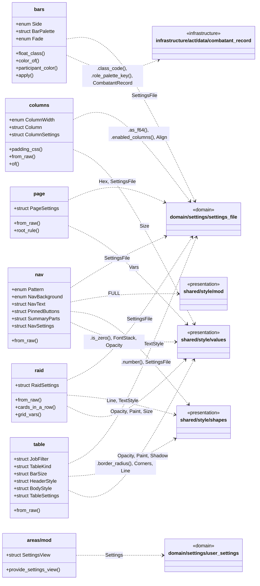

#### `areas/bars`  (172 lines)

The graph bars behind the rows: their colours, the fade, the side the small bars float to, and which small bars show.

| Item | Kind | What it does | Produces | Calls / uses |
|---|---|---|---|---|
| `Side` | enum | The side the small bars (pet, shield, overheal) float to. | value type | — |
| `float_class` | method | The class that floats a bar to this side. | `&'static str` | — |
| `PaletteMode` *(private)* | enum | "Palette": the bars follow the player's job, the player's role, or are only told apart as me and the others. | value type | — |
| `BarPalette` | struct | The colours of the bars: a colour per job, per role, per small bar, and for me and the others, with the rules that pick one. | value type | — |
| `color_of` | method | CSS colour of a bar. | `String` | — |
| `participant_color` | method | Colour of a player's main bar. | `String` | `infrastructure/act/data/combatant_record`: `.class_code()`, `.role_palette_key()`, `CombatantRecord` |
| `Fade` | enum | The fade-in gradient of the bars ("Gradient" and its direction). | value type | — |
| `apply` | method | The background of a bar of this colour. | `String` | — |
| `BarSettings` | struct |  | value type | — |
| `from_raw` | method | The only place that knows the bars' settings keys. | `Self` | `domain/settings/settings_file`: `SettingsFile` |
| `side` | method | The side the small bars of the damage or the healing table float to. | `Side` | — |

#### `areas/columns`  (79 lines)

The columns of the damage and healing tables: which are shown, in which order, and how each is laid out.

| Item | Kind | What it does | Produces | Calls / uses |
|---|---|---|---|---|
| `ColumnWidth` | enum | A column's width: a size, or the rest of the row. | value type | `shared/style/values`: `Size` |
| `Column` | struct | One column of a table, as every cell of it is laid out. | value type | `domain/settings/settings_file`: `Align`; `shared/style/values`: `Size` |
| `padding_css` | method | `padding` as the value of the attribute: nothing above or below, the padding on both sides. | `String` (CSS) | — |
| `ColumnSettings` | struct |  | value type | — |
| `from_raw` | method | The only place that knows how the columns are stored: `Order` lists a table's columns, `ColData` defines each, and a column whose switch for the table is off is not shown (`SettingsFile::enabled_columns`; the header and the body … | `Self` | `domain/settings/settings_file`: `.as_f64()`, `.enabled_columns()`, `SettingsFile`; `shared/style/values`: `Size` |
| `of` | method | The columns of the damage or the healing table, in the order they are drawn. | `&[Column]` | — |

#### `areas/mod`  (57 lines)

The settings, one typed struct per area of the UI.

| Item | Kind | What it does | Produces | Calls / uses |
|---|---|---|---|---|
| `SettingsView` | struct | Each area as a memo: it only changes when that area's settings do. | value type | — |
| `provide_settings_view` | function | Creates the areas from the settings and provides them to everything below. | `SettingsView` | `domain/settings/user_settings`: `Settings` |

#### `areas/nav`  (225 lines)

The navigation bar: its style, its layout, which buttons are pinned and which parts of the summary line show.

| Item | Kind | What it does | Produces | Calls / uses |
|---|---|---|---|---|
| `Pattern` | enum | The pattern drawn over the bar's colour. | value type | — |
| `NavBackground` | enum | The bar's background: its colour, or one of the patterns drawn over it. | value type | `shared/style/values`: `Paint` |
| `NavText` | struct | One of the texts of the bar (the time, the target, the summary). | value type | `shared/style/values`: `FontStack`, `Paint`, `Size` |
| `PinnedButtons` | struct | The buttons the user pinned to the bar (the ⋮ button is always there). | value type | — |
| `SummaryParts` | struct | Which parts of the summary line show ("Display Type of Combatant Data"). | value type | — |
| `NavSettings` | struct |  | value type | `shared/style/shapes`: `Corners`, `Line`; `shared/style/values`: `Paint`, `Size` |
| `from_raw` | method | The only place that knows the nav bar's settings keys. | `Self` | `domain/settings/settings_file`: `SettingsFile`; `shared/style/mod`: `FULL`; `shared/style/values`: `.is_zero()` |
| `bar_vars` | method | The only place that knows the nav bar's variable names: set once on the `nav` element, inherited by everything in it. | `String` (CSS) | `shared/style/values`: `Vars` |
| `time_vars` | method | The variables of the time's text, for its cells. | `String` (CSS) | — |
| `target_vars` | method | The variables of the target's text, for its cells. | `String` (CSS) | — |
| `summary_vars` | method | The variables of the summary's text, for its cells. | `String` (CSS) | — |

#### `areas/page`  (59 lines)

The page as a whole: the language, the font size and background of the page, the accent colour, and the switches that are not about one area (merging pets into their owners, tooltips, the corner handle).

| Item | Kind | What it does | Produces | Calls / uses |
|---|---|---|---|---|
| `PageSettings` | struct |  | value type | `domain/settings/settings_file`: `Hex` |
| `from_raw` | method | The only place that knows the page's settings keys. | `Self` | `domain/settings/settings_file`: `SettingsFile` |
| `root_rule` | method | The rule that sets the page-wide variables on `:root`, which in an HTML document is the `<html>` element: there is no element of the app's own to carry them. | `String` (CSS) | `shared/style/values`: `Vars` |

#### `areas/raid`  (84 lines)

Raid mode: the grid of small cards, one per player.

| Item | Kind | What it does | Produces | Calls / uses |
|---|---|---|---|---|
| `RaidSettings` | struct |  | value type | `shared/style/shapes`: `Line`, `TextStyle`; `shared/style/values`: `Opacity`, `Paint`, `Size` |
| `from_raw` | method | The only place that knows the raid grid's settings keys. | `Self` | `domain/settings/settings_file`: `SettingsFile`; `shared/style/shapes`: `TextStyle` |
| `cards_in_a_row` | method | The number of cards in a row. | `usize` | — |
| `grid_vars` | method | Every variable shared by every card of the grid, set once on its container. | `String` (CSS) | `shared/style/values`: `Vars` |

#### `areas/table`  (245 lines)

The damage and healing tables: which are shown and in which order, how many rows, which jobs, and the style of the header and the body.

| Item | Kind | What it does | Produces | Calls / uses |
|---|---|---|---|---|
| `CornerCoverage` *(private)* | enum | "Apply to" of the corner radius: the header, the body, or both. | value type | — |
| `JobFilter` | struct | Which jobs a table shows ("DPS_T" = tanks in the damage table, "HPS_H" = healers in the healing table, ...). | value type | — |
| `TableKind` | struct | What belongs to one of the two tables. | value type | `shared/style/values`: `Size` |
| `BarSize` | struct | A graph bar's size and opacity; its margin is what is left of the row's height. | value type | `shared/style/values`: `Opacity`, `Size` |
| `HeaderStyle` | struct |  | value type | `shared/style/shapes`: `Corners`, `Line`, `TextStyle`; `shared/style/values`: `Paint`, `Size` |
| `BodyStyle` | struct |  | value type | `shared/style/shapes`: `Corners`, `Line`, `TextStyle`; `shared/style/values`: `Paint`, `Size` |
| `TableSettings` | struct |  | value type | — |
| `from_raw` | method | The only place that knows the tables' settings keys. | `Self` | `domain/settings/settings_file`: `.number()`, `SettingsFile`; `shared/style/shapes`: `Corners`, `Line`, `TextStyle`; `shared/style/values`: `Opacity`, `Shadow`, `Size` |
| `kind` | method | The damage or the healing table's own settings. | `&TableKind` | — |
| `raid_mode` | method | Raid mode for a fight with this many players. | `bool` | — |
| `tables_in_order` | method | The tables to draw, in order: `true` is the healing table. | `Vec<bool>` | — |
| `body_height_rem` | method | Height in rem of a table's body: rows are as tall as the row plus its line, up to the row limit. | `f64` | — |
| `header_vars` | method | Every variable shared by the header cells of a table, for the wrapper (every cell inherits them); the history list has the same header. | `String` (CSS) | `shared/style/values`: `Vars` |
| `body_vars` | method | Every variable shared by the rows of a table's body: the row and its bars, and the text of own and other rows (both, each row picks). | `String` (CSS) | `shared/style/values`: `Vars`; `shared/style/shapes`: `.border_radius()` |

### 6.3 `combat_tables`

The DPS / HPS tables, the raid grid and the graph bars behind the rows.

```mermaid
classDiagram
  direction LR
  class combat_tables_cell_classes["cell_classes"]
  class combat_tables_graph_bars["graph_bars"]
  combat_tables_graph_bars : +struct BarGeometry
  combat_tables_graph_bars : +struct Flip
  combat_tables_graph_bars : +flip()
  combat_tables_graph_bars : +small_bar_geometry()
  combat_tables_graph_bars : +struct BarHistory
  combat_tables_graph_bars : +forget_all()
  combat_tables_graph_bars : +graph_bars()
  class combat_tables_mod["combat_tables/mod"]
  combat_tables_mod : +CombatTables() «C»
  class combat_tables_raid_grid["raid_grid"]
  combat_tables_raid_grid : +raid_grid()
  combat_tables_raid_grid : +RaidCard() «C»
  class combat_tables_standard_table["standard_table"]
  combat_tables_standard_table : +standard_table()
  combat_tables_standard_table : +TableHeader() «C»
  combat_tables_standard_table : +PlayerRow() «C»
  class combat_tables_table_environment["table_environment"]
  combat_tables_table_environment : +struct TableEnvironment
  combat_tables_table_environment : +new()
  combat_tables_table_environment : +cell_context()
  combat_tables_table_environment : +struct SharedEnvironment
  combat_tables_table_environment : +new()
  class combat_tables_visible_participants["visible_participants"]
  combat_tables_visible_participants : +struct RankedPlayer
  combat_tables_visible_participants : +visible_participants()
  class x_infrastructure_act_data_combatant_record["infrastructure/act/data/combatant_record"]
  <<infrastructure>> x_infrastructure_act_data_combatant_record
  class x_areas_bars["areas/bars"]
  <<presentation>> x_areas_bars
  class x_shared_palette["shared/palette"]
  <<presentation>> x_shared_palette
  class x_application_app_state_contexts_settings_context["application/app_state/contexts/settings_context"]
  <<application>> x_application_app_state_contexts_settings_context
  class x_application_app_state_contexts_settings_screen_context["application/app_state/contexts/settings_screen_context"]
  <<application>> x_application_app_state_contexts_settings_screen_context
  class x_application_app_state_contexts_tables_context["application/app_state/contexts/tables_context"]
  <<application>> x_application_app_state_contexts_tables_context
  class x_application_app_state_sample_fight["application/app_state/sample_fight"]
  <<application>> x_application_app_state_sample_fight
  class x_infrastructure_act_data_combat_data_message["infrastructure/act/data/combat_data_message"]
  <<infrastructure>> x_infrastructure_act_data_combat_data_message
  class x_areas_columns["areas/columns"]
  <<presentation>> x_areas_columns
  class x_areas_mod["areas/mod"]
  <<presentation>> x_areas_mod
  class x_areas_page["areas/page"]
  <<presentation>> x_areas_page
  class x_areas_raid["areas/raid"]
  <<presentation>> x_areas_raid
  class x_areas_table["areas/table"]
  <<presentation>> x_areas_table
  class x_overlay_plugin_context["overlay_plugin_context"]
  <<presentation>> x_overlay_plugin_context
  class x_domain_formatting_column_cell["domain/formatting/column_cell"]
  <<domain>> x_domain_formatting_column_cell
  class x_infrastructure_act_data_encounter_record["infrastructure/act/data/encounter_record"]
  <<infrastructure>> x_infrastructure_act_data_encounter_record
  class x_shared_row_identity["shared/row_identity"]
  <<presentation>> x_shared_row_identity
  class x_shared_text_display["shared/text_display"]
  <<presentation>> x_shared_text_display
  class x_application_i18n["application/i18n"]
  <<application>> x_application_i18n
  class x_domain_combat_combatant_kind["domain/combat/combatant_kind"]
  <<domain>> x_domain_combat_combatant_kind
  class x_domain_translations_mod["domain/translations/mod"]
  <<domain>> x_domain_translations_mod
  class x_domain_formatting_mod["domain/formatting/mod"]
  <<domain>> x_domain_formatting_mod
  class x_domain_settings_user_settings["domain/settings/user_settings"]
  <<domain>> x_domain_settings_user_settings
  combat_tables_graph_bars ..> x_infrastructure_act_data_combatant_record : CombatantRecord
  combat_tables_graph_bars ..> x_areas_bars : .color_of(), .float_class(), .participant_color() 
  combat_tables_graph_bars ..> combat_tables_table_environment : SharedEnvironment
  combat_tables_graph_bars ..> x_shared_palette : percent_of_whole
  combat_tables_mod ..> x_application_app_state_contexts_settings_context : SettingsContext, context SettingsContext
  combat_tables_mod ..> x_application_app_state_contexts_settings_screen_context : SettingsScreenContext, context SettingsScreenContext
  combat_tables_mod ..> x_application_app_state_contexts_tables_context : TablesContext, context TablesContext
  combat_tables_mod ..> x_application_app_state_sample_fight : sample_combat_message
  combat_tables_mod ..> x_infrastructure_act_data_combat_data_message : CombatDataMessage
  combat_tables_mod ..> x_areas_bars : SettingsView.bars
  combat_tables_mod ..> x_areas_columns : SettingsView.columns
  combat_tables_mod ..> x_areas_mod : SettingsView, context SettingsView
  combat_tables_mod ..> x_areas_page : SettingsView.page
  combat_tables_mod ..> x_areas_raid : SettingsView.raid
  combat_tables_mod ..> x_areas_table : .raid_mode(), .tables_in_order(), SettingsView.table
  combat_tables_mod ..> combat_tables_graph_bars : .forget_all(), context BarHistory
  combat_tables_mod ..> x_overlay_plugin_context : .get_is_encounter_active(), OverlayPluginContext, context OverlayPluginContext
  combat_tables_raid_grid ..> x_domain_formatting_column_cell : cell_fragments, cell_fragments_ranked
  combat_tables_raid_grid ..> x_infrastructure_act_data_combatant_record : CombatantRecord
  combat_tables_raid_grid ..> x_infrastructure_act_data_encounter_record : EncounterRecord
  combat_tables_raid_grid ..> x_areas_bars : .participant_color()
  combat_tables_raid_grid ..> x_areas_raid : .cards_in_a_row(), .grid_vars()
  combat_tables_raid_grid ..> combat_tables_mod : table_label
  combat_tables_raid_grid ..> combat_tables_table_environment : .cell_context(), SharedEnvironment
  combat_tables_raid_grid ..> combat_tables_visible_participants : visible_participants
  combat_tables_raid_grid ..> x_shared_row_identity : row_element_id
  combat_tables_raid_grid ..> x_shared_text_display : job_icon_view, text_fragments_view
  combat_tables_standard_table ..> x_application_app_state_contexts_tables_context : TablesContext, context TablesContext
  combat_tables_standard_table ..> x_application_i18n : translate
  combat_tables_standard_table ..> x_domain_combat_combatant_kind : CombatantKind
  combat_tables_standard_table ..> x_domain_formatting_column_cell : CellContext, cell_fragments_ranked
  combat_tables_standard_table ..> x_domain_translations_mod : translations
  combat_tables_standard_table ..> x_infrastructure_act_data_combatant_record : CombatantRecord
  combat_tables_standard_table ..> x_infrastructure_act_data_encounter_record : EncounterRecord
  combat_tables_standard_table ..> x_areas_columns : .padding_css(), Column
  combat_tables_standard_table ..> x_areas_table : .body_height_rem(), .body_vars(), .header_vars()
  combat_tables_standard_table ..> combat_tables_cell_classes : BODY_CELL_BORDER, HEADER_CELL, HEADER_TABLE
  combat_tables_standard_table ..> combat_tables_graph_bars : graph_bars
  combat_tables_standard_table ..> combat_tables_mod : table_label
  combat_tables_standard_table ..> combat_tables_table_environment : .cell_context(), SharedEnvironment
  combat_tables_standard_table ..> combat_tables_visible_participants : visible_participants
  combat_tables_standard_table ..> x_shared_row_identity : row_element_id
  combat_tables_standard_table ..> x_shared_text_display : job_icon_view, text_fragments_view
  combat_tables_table_environment ..> x_application_i18n : dictionary_title
  combat_tables_table_environment ..> x_domain_formatting_column_cell : CellContext
  combat_tables_table_environment ..> x_domain_formatting_mod : LIMIT_BREAK_JOB_CODE
  combat_tables_table_environment ..> x_domain_settings_user_settings : Settings
  combat_tables_table_environment ..> x_areas_bars : BarSettings
  combat_tables_table_environment ..> x_areas_columns : ColumnSettings
  combat_tables_table_environment ..> x_areas_raid : RaidSettings
  combat_tables_table_environment ..> x_areas_table : TableSettings
  combat_tables_visible_participants ..> x_domain_combat_combatant_kind : CombatantKind
  combat_tables_visible_participants ..> x_infrastructure_act_data_combatant_record : .is_crafter_or_gatherer(), .is_healer(), .is_tank() 
  combat_tables_visible_participants ..> x_areas_table : JobFilter
```

#### `combat_tables/cell_classes`  (14 lines)

The classes the cells of a table share, written once: the standard table and the history list draw the same header and the same lines between cells.

| Item | Kind | What it does | Produces | Calls / uses |
|---|---|---|---|---|
| `BODY_CELL_BORDER` | const | The line to the right of a body cell, all but the last: the vertical line between cells (`--chrome-cell-border`). | constant | — |
| `HEADER_CELL` | const | A header cell: the header's background and height, the rounded corners of the first and of the last (so they follow whichever columns are shown), and the line to the right of all but the last (`--chrome-header-cell-border`). | constant | — |
| `HEADER_TABLE` | const | The table that holds the header cells: its margin, and the text rules of the header (`themed-text`). | constant | — |

#### `combat_tables/graph_bars`  (237 lines)

The coloured bar behind a row and the small pet / overheal / shield bars.

| Item | Kind | What it does | Produces | Calls / uses |
|---|---|---|---|---|
| `BarWidths` *(private)* | struct | Bar widths in whole percent, truncated like the original's `parseInt`. | value type | — |
| `bar_widths` *(private)* | function |  | `BarWidths` | `infrastructure/act/data/combatant_record`: `CombatantRecord`; `shared/palette`: `percent_of_whole` |
| `bar_classes` *(private)* | function | The size, margin, opacity and corners of the bar of a kind, as utility classes reading the variables the table sets (`--chrome-bar-{kind}-height`, `-margin`, `-opacity`, and `--chrome-bar-radius`, from `TableSettings::body_vars`). | `&'static str` | — |
| `BarGeometry` | struct | Where a bar is, in percent of the row's width: the edge it is anchored to (its left edge, or its right edge for a bar floated right, measured from the row's left) and its width. | value type | — |
| `Flip` | struct | The transform that shows a bar at its previous geometry: `translateX(dx% of its own width) scaleX(sx)`, taken about the anchored edge. | value type | — |
| `flip` | function | The starting transform for a bar that moves from `old` to `new`; `None` when nothing needs animating (it did not move, or it ends up with no width, which cannot be expressed as a scale and just snaps). | `Option<Flip>` | — |
| `small_bar_geometry` | function | Geometry of the small bars of one row. | `Option<Vec<BarGeometry>>` | — |
| `Remembered` *(private)* | struct |  | value type | — |
| `BarHistory` | struct | What every bar drawn so far looked like, so the next draw knows where each one comes from. | value type | — |
| `forget_all` | method |  | — | — |
| `BarAnimation` *(private)* | struct | The classes and inline custom properties that play a bar's move. | value type | — |
| `animation_of` *(private)* | function | Decides the animation of the bar `key` (which row, which bar) now that it should be at `geometry`. | `BarAnimation` | — |
| `graph_bars` | function | Draws the main bar and the small pet / overheal / shield bars of one row, each with the move it should play (see `animation_of`). | DOM (Dioxus `Element`) | `combat_tables/table_environment`: `SharedEnvironment`; `infrastructure/act/data/combatant_record`: `CombatantRecord`; `areas/bars`: `.color_of()`, `.float_class()`, `.participant_color()` |

#### `combat_tables/mod`  (100 lines)

The DPS and HPS tables (rows with graph bars) and the compact "raid mode" grid.

| Item | Kind | What it does | Produces | Calls / uses |
|---|---|---|---|---|
| `table_label` *(private)* | function | "DPS" or "HPS": the prefix used in element ids, column flags and setting keys. | `&'static str` | — |
| `empty_tables` *(private)* | function | No tables: also the moment the bars forget where they were (the original clears its bar sizes when a fight is saved). | DOM (Dioxus `Element`) | `combat_tables/graph_bars`: `.forget_all()`; `combat_tables/graph_bars`: context BarHistory |
| `CombatTables` «C» | component | Entry of the tables: reads the displayed combat data and the settings, then draws the damage / healing tables, standard or raid grid, in the configured order. | DOM (Dioxus `Element`) | `application/app_state/contexts/settings_context`: `SettingsContext`; `application/app_state/contexts/settings_screen_context`: `SettingsScreenContext`; `application/app_state/contexts/tables_context`: `TablesContext`; `overlay_plugin_context`: `.get_is_encounter_active()`, `OverlayPluginContext`; `infrastructure/act/data/combat_data_message`: `CombatDataMessage`; `areas/mod`: `SettingsView`; `application/app_state/sample_fight`: `sample_combat_message`; … (+11) |

#### `combat_tables/raid_grid`  (74 lines)

Raid mode: one small card per player (colour strip, icon, name, DPS or HPS).

| Item | Kind | What it does | Produces | Calls / uses |
|---|---|---|---|---|
| `raid_grid` | function | One grid of cards for a table: the visible players, each as a `raid_card`. | DOM (Dioxus `Element`) | `combat_tables/table_environment`: `SharedEnvironment`; `combat_tables/visible_participants`: `visible_participants`; `infrastructure/act/data/combatant_record`: `CombatantRecord`; `infrastructure/act/data/encounter_record`: `EncounterRecord`; `shared/row_identity`: `row_element_id`; `combat_tables/mod`: `table_label`; `areas/raid`: `.cards_in_a_row()`, `.grid_vars()` |
| `RaidCard` «C» | component | One card of the raid grid. | DOM (Dioxus `Element`) | `combat_tables/table_environment`: `.cell_context()`, `SharedEnvironment`; `domain/formatting/column_cell`: `cell_fragments`, `cell_fragments_ranked`; `infrastructure/act/data/combatant_record`: `CombatantRecord`; `infrastructure/act/data/encounter_record`: `EncounterRecord`; `shared/row_identity`: `row_element_id`; `shared/text_display`: `job_icon_view`, `text_fragments_view`; `areas/bars`: `.participant_color()` |

#### `combat_tables/standard_table`  (201 lines)

The normal table: a header row and one row per player.

| Item | Kind | What it does | Produces | Calls / uses |
|---|---|---|---|---|
| `standard_table` | function | One whole table: the header and a body with a row per visible player. Sets every shared CSS variable once on the wrappers. | DOM (Dioxus `Element`) | `combat_tables/table_environment`: `SharedEnvironment`; `combat_tables/visible_participants`: `visible_participants`; `infrastructure/act/data/combatant_record`: `CombatantRecord`; `infrastructure/act/data/encounter_record`: `EncounterRecord`; `shared/row_identity`: `row_element_id`; `combat_tables/mod`: `table_label`; `areas/table`: `.body_height_rem()`, `.body_vars()`, `.header_vars()` |
| `TableHeader` «C» | component | The column titles. | DOM (Dioxus `Element`) | `combat_tables/cell_classes`: `HEADER_CELL`, `HEADER_TABLE`; `application/i18n`: `translate`; `domain/translations/mod`: `translations`; `areas/columns`: `.padding_css()`, `Column` |
| `PlayerRow` «C» | component | One player's row: the cells, then the bars behind them. | DOM (Dioxus `Element`) | `combat_tables/graph_bars`: `graph_bars`; `combat_tables/table_environment`: `.cell_context()`, `SharedEnvironment`; `application/app_state/contexts/tables_context`: `TablesContext`; `domain/combat/combatant_kind`: `CombatantKind`; `infrastructure/act/data/combatant_record`: `CombatantRecord`; `infrastructure/act/data/encounter_record`: `EncounterRecord`; `shared/row_identity`: `row_element_id`; … (+2) |
| `cell` *(private)* | function | One body cell: the column's value for the player, as text fragments. | DOM (Dioxus `Element`) | `combat_tables/cell_classes`: `BODY_CELL_BORDER`; `domain/formatting/column_cell`: `CellContext`, `cell_fragments_ranked`; `infrastructure/act/data/combatant_record`: `CombatantRecord`; `infrastructure/act/data/encounter_record`: `EncounterRecord`; `areas/columns`: `.padding_css()`, `Column`; `shared/text_display`: `text_fragments_view` |
| `job_icon_cell` *(private)* | function | The job icon cell. | DOM (Dioxus `Element`) | `combat_tables/cell_classes`: `BODY_CELL_BORDER`; `combat_tables/table_environment`: `SharedEnvironment`; `infrastructure/act/data/combatant_record`: `CombatantRecord`; `areas/columns`: `.padding_css()`, `Column`; `shared/text_display`: `job_icon_view` |

#### `combat_tables/table_environment`  (87 lines)

Everything the table drawing needs, bundled so that rows can take it as one prop.

| Item | Kind | What it does | Produces | Calls / uses |
|---|---|---|---|---|
| `TableEnvironment` | struct |  | value type | `domain/settings/user_settings`: `Settings`; `areas/bars`: `BarSettings`; `areas/columns`: `ColumnSettings`; `areas/raid`: `RaidSettings`; `areas/table`: `TableSettings` |
| `new` | method |  | `TableEnvironment` | `application/i18n`: `dictionary_title`; `domain/formatting/mod`: `LIMIT_BREAK_JOB_CODE`; `domain/settings/user_settings`: `Settings`; `areas/bars`: `BarSettings`; `areas/columns`: `ColumnSettings`; `areas/raid`: `RaidSettings`; `areas/table`: `TableSettings` |
| `cell_context` | method | The text rules for the cells. | `CellContext<'_>` | `domain/formatting/column_cell`: `CellContext` |
| `SharedEnvironment` | struct | A `TableEnvironment` shared by every row. | value type | — |
| `new` | method |  | `Self` | — |

#### `combat_tables/visible_participants`  (42 lines)

Which combatants a table shows, in the order it should show them.

| Item | Kind | What it does | Produces | Calls / uses |
|---|---|---|---|---|
| `passes_job_filter` *(private)* | function | The job filter of the table ("tanks in the damage table", "healers in the healing table", ...). | `bool` | `domain/combat/combatant_kind`: `CombatantKind`; `areas/table`: `JobFilter`; `infrastructure/act/data/combatant_record`: `.is_crafter_or_gatherer()`, `.is_healer()`, `.is_tank()` |
| `RankedPlayer` | struct | A row of a table together with its rank in that table (0 = first), which is what `rank` in the name cell prints. | value type | `infrastructure/act/data/combatant_record`: `CombatantRecord` |
| `visible_participants` | function | Combatants a table shows, in the order it draws them, after the job filter. | `Vec<RankedPlayer<'a>>` | `areas/table`: `JobFilter`; `infrastructure/act/data/combatant_record`: `CombatantRecord` |

### 6.4 `dropdown_menus`

Pop-up menus: the ⋮ menu and the pick-one / toggle lists.

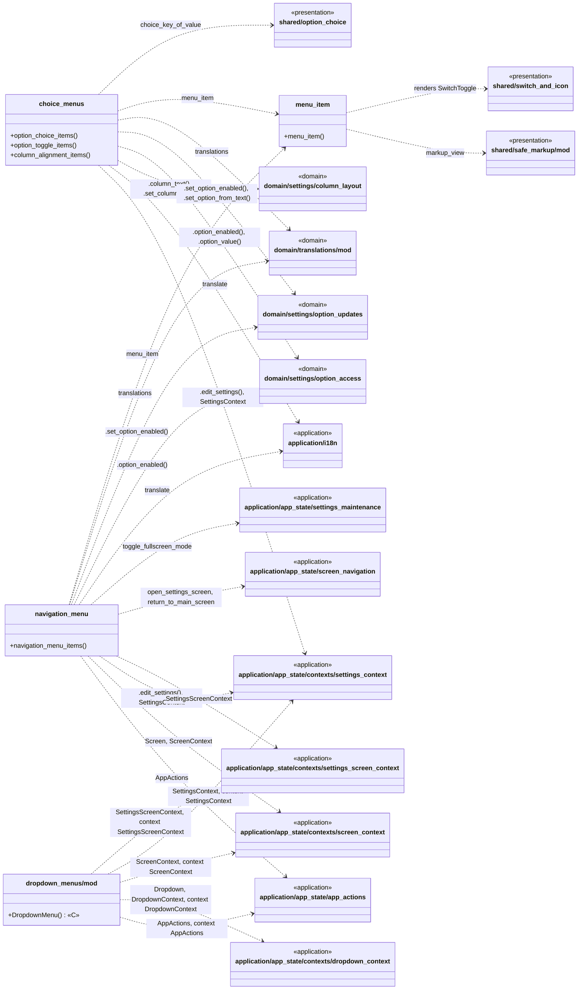

#### `dropdown_menus/choice_menus`  (51 lines)

Menus for picking values: one of several, several on/off options, or a column alignment.

| Item | Kind | What it does | Produces | Calls / uses |
|---|---|---|---|---|
| `option_choice_items` | function | Pick one value of a setting. | DOM (Dioxus `Element`) | `dropdown_menus/menu_item`: `menu_item`; `application/app_state/contexts/settings_context`: `.edit_settings()`, `SettingsContext`; `application/i18n`: `translate`; `shared/option_choice`: `choice_key_of_value`; `domain/settings/option_access`: `.option_value()`; `domain/settings/option_updates`: `.set_option_from_text()` |
| `option_toggle_items` | function | Several independent on/off options (the job filters). | DOM (Dioxus `Element`) | `dropdown_menus/menu_item`: `menu_item`; `application/app_state/contexts/settings_context`: `.edit_settings()`, `SettingsContext`; `domain/settings/option_access`: `.option_enabled()`; `domain/settings/option_updates`: `.set_option_enabled()` |
| `column_alignment_items` | function | Left / center / right for a column's header or body text. | DOM (Dioxus `Element`) | `dropdown_menus/menu_item`: `menu_item`; `application/app_state/contexts/settings_context`: `.edit_settings()`, `SettingsContext`; `application/i18n`: `translate`; `domain/translations/mod`: `translations`; `domain/settings/column_layout`: `.column_text()`, `.set_column_field()` |

#### `dropdown_menus/menu_item`  (17 lines)

One line of a pop-up menu.

| Item | Kind | What it does | Produces | Calls / uses |
|---|---|---|---|---|
| `menu_item` | function | A clickable line with an HTML label. | DOM (Dioxus `Element`) | **renders** `SwitchToggle`; `shared/safe_markup/mod`: `markup_view`; `shared/switch_and_icon`: `SwitchToggle` |

#### `dropdown_menus/mod`  (33 lines)

Pop-up menus.

| Item | Kind | What it does | Produces | Calls / uses |
|---|---|---|---|---|
| `DropdownMenu` «C» | component | The pop-up menu currently open (⋮ menu, or a choice list), chosen from `DropdownContext::open_dropdown`. | DOM (Dioxus `Element`) | `application/app_state/app_actions`: `AppActions`; `application/app_state/contexts/dropdown_context`: `Dropdown`, `DropdownContext`; `application/app_state/contexts/screen_context`: `ScreenContext`; `application/app_state/contexts/settings_context`: `SettingsContext`; `application/app_state/contexts/settings_screen_context`: `SettingsScreenContext`; `application/app_state/app_actions`: context AppActions; `application/app_state/contexts/dropdown_context`: context DropdownContext; … (+3) |

#### `dropdown_menus/navigation_menu`  (77 lines)

The ⋮ menu.

| Item | Kind | What it does | Produces | Calls / uses |
|---|---|---|---|---|
| `MenuEntry` *(private)* | struct | One entry of the schema's menu definition. | value type | — |
| `navigation_menu_items` | function |  | DOM (Dioxus `Element`) | `dropdown_menus/menu_item`: `menu_item`; `application/app_state/app_actions`: `AppActions`; `application/app_state/contexts/screen_context`: `Screen`, `ScreenContext`; `application/app_state/contexts/settings_context`: `SettingsContext`; `application/app_state/contexts/settings_screen_context`: `SettingsScreenContext`; `application/i18n`: `translate`; `domain/translations/mod`: `translations` |
| `is_menu_switch_on` *(private)* | function |  | `bool` | `application/app_state/contexts/settings_context`: `SettingsContext`; `application/app_state/contexts/settings_screen_context`: `SettingsScreenContext`; `domain/settings/option_access`: `.option_enabled()` |
| `toggle_menu_switch` *(private)* | function |  | side effect (signals / DOM events) | `application/app_state/contexts/settings_context`: `.edit_settings()`, `SettingsContext`; `application/app_state/contexts/settings_screen_context`: `SettingsScreenContext`; `domain/settings/option_access`: `.option_enabled()`; `domain/settings/option_updates`: `.set_option_enabled()` |
| `run_menu_action` *(private)* | function |  | side effect (signals / DOM events) | `application/app_state/screen_navigation`: `open_settings_screen`, `return_to_main_screen`; `application/app_state/settings_maintenance`: `toggle_fullscreen_mode`; `application/app_state/app_actions`: `AppActions` |

### 6.5 `history_screen`

The list of finished encounters.

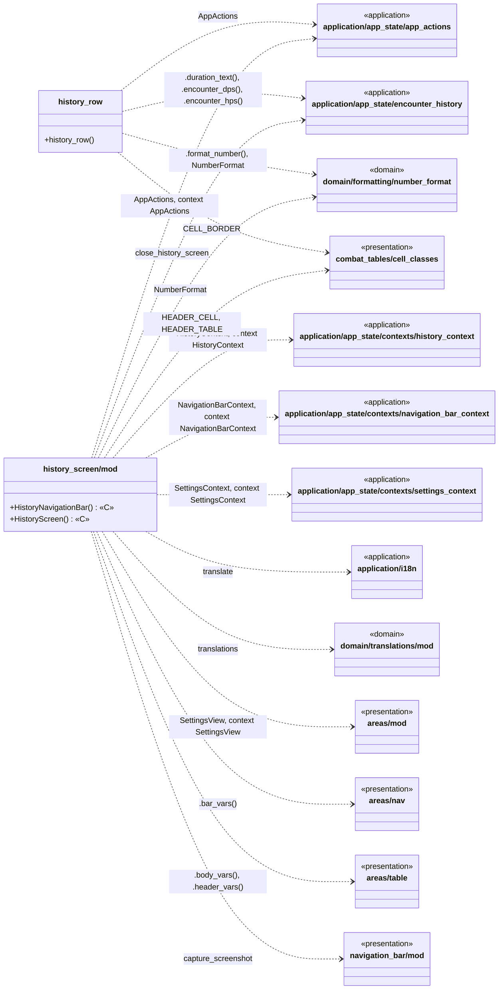

#### `history_screen/history_row`  (47 lines)

One line of the history list.

| Item | Kind | What it does | Produces | Calls / uses |
|---|---|---|---|---|
| `history_row` | function | `number_format` is built once per screen by `HistoryScreen`; it does not depend on the row. | DOM (Dioxus `Element`) | `application/app_state/encounter_history`: `.duration_text()`, `.encounter_dps()`, `.encounter_hps()`; `application/app_state/app_actions`: `AppActions`; `domain/formatting/number_format`: `.format_number()`, `NumberFormat`; `combat_tables/cell_classes`: `CELL_BORDER` |

#### `history_screen/mod`  (98 lines)

Finished encounters (History screen).

| Item | Kind | What it does | Produces | Calls / uses |
|---|---|---|---|---|
| `HistoryNavigationBar` «C» | component | Top bar of the History screen: title, capture and a close button. | DOM (Dioxus `Element`) | `application/app_state/encounter_history`: `close_history_screen`; `application/app_state/app_actions`: `AppActions`; `application/app_state/contexts/navigation_bar_context`: `NavigationBarContext`; `application/i18n`: `translate`; `domain/translations/mod`: `translations`; `areas/mod`: `SettingsView`; `navigation_bar/mod`: `capture_screenshot`; … (+4) |
| `HistoryScreen` «C» | component | The History screen: the list of finished encounters with the same header as the tables. | DOM (Dioxus `Element`) | `application/app_state/app_actions`: `AppActions`; `application/app_state/contexts/history_context`: `HistoryContext`; `application/app_state/contexts/settings_context`: `SettingsContext`; `domain/formatting/number_format`: `NumberFormat`; `areas/mod`: `SettingsView`; `combat_tables/cell_classes`: `HEADER_CELL`, `HEADER_TABLE`; `areas/table`: `.body_vars()`, `.header_vars()`; … (+4) |

### 6.6 `navigation_bar`

The top bar of the main screen and its buttons.

```mermaid
classDiagram
  direction LR
  class navigation_bar_buttons["buttons"]
  navigation_bar_buttons : +NavigationButtons() «C»
  navigation_bar_buttons : +NavigationButton() «C»
  class navigation_bar_mod["navigation_bar/mod"]
  navigation_bar_mod : +capture_screenshot()
  navigation_bar_mod : +NavigationBar() «C»
  class navigation_bar_summary_line["summary_line"]
  navigation_bar_summary_line : +summary_line()
  class x_application_app_state_app_actions["application/app_state/app_actions"]
  <<application>> x_application_app_state_app_actions
  class x_application_app_state_contexts_dropdown_context["application/app_state/contexts/dropdown_context"]
  <<application>> x_application_app_state_contexts_dropdown_context
  class x_application_app_state_contexts_navigation_bar_context["application/app_state/contexts/navigation_bar_context"]
  <<application>> x_application_app_state_contexts_navigation_bar_context
  class x_application_app_state_contexts_notices_context["application/app_state/contexts/notices_context"]
  <<application>> x_application_app_state_contexts_notices_context
  class x_application_app_state_encounter_history["application/app_state/encounter_history"]
  <<application>> x_application_app_state_encounter_history
  class x_application_i18n["application/i18n"]
  <<application>> x_application_i18n
  class x_domain_translations_mod["domain/translations/mod"]
  <<domain>> x_domain_translations_mod
  class x_areas_mod["areas/mod"]
  <<presentation>> x_areas_mod
  class x_overlay_plugin_context["overlay_plugin_context"]
  <<presentation>> x_overlay_plugin_context
  class x_application_app_state_contexts_settings_context["application/app_state/contexts/settings_context"]
  <<application>> x_application_app_state_contexts_settings_context
  class x_application_app_state_contexts_tables_context["application/app_state/contexts/tables_context"]
  <<application>> x_application_app_state_contexts_tables_context
  class x_application_app_state_sample_fight["application/app_state/sample_fight"]
  <<application>> x_application_app_state_sample_fight
  class x_application_app_state_toast_notifications["application/app_state/toast_notifications"]
  <<application>> x_application_app_state_toast_notifications
  class x_areas_nav["areas/nav"]
  <<presentation>> x_areas_nav
  class x_areas_page["areas/page"]
  <<presentation>> x_areas_page
  class x_common_javascript_compat["common/javascript_compat"]
  <<common>> x_common_javascript_compat
  class x_domain_formatting_column_cell["domain/formatting/column_cell"]
  <<domain>> x_domain_formatting_column_cell
  class x_domain_formatting_mod["domain/formatting/mod"]
  <<domain>> x_domain_formatting_mod
  class x_domain_formatting_number_format["domain/formatting/number_format"]
  <<domain>> x_domain_formatting_number_format
  class x_domain_settings_option_access["domain/settings/option_access"]
  <<domain>> x_domain_settings_option_access
  class x_domain_settings_option_updates["domain/settings/option_updates"]
  <<domain>> x_domain_settings_option_updates
  class x_domain_settings_user_settings["domain/settings/user_settings"]
  <<domain>> x_domain_settings_user_settings
  class x_infrastructure_act_data_combatant_record["infrastructure/act/data/combatant_record"]
  <<infrastructure>> x_infrastructure_act_data_combatant_record
  class x_infrastructure_act_data_encounter_record["infrastructure/act/data/encounter_record"]
  <<infrastructure>> x_infrastructure_act_data_encounter_record
  navigation_bar_buttons ..> x_application_app_state_app_actions : AppActions, context AppActions
  navigation_bar_buttons ..> x_application_app_state_contexts_dropdown_context : Dropdown, DropdownContext, context DropdownContext
  navigation_bar_buttons ..> x_application_app_state_contexts_navigation_bar_context : NavigationBarContext, context NavigationBarContext
  navigation_bar_buttons ..> x_application_app_state_contexts_notices_context : NoticesContext, context NoticesContext
  navigation_bar_buttons ..> x_application_app_state_encounter_history : open_history_screen
  navigation_bar_buttons ..> x_application_i18n : translate
  navigation_bar_buttons ..> x_domain_translations_mod : translations
  navigation_bar_buttons ..> x_areas_mod : SettingsView, context SettingsView
  navigation_bar_buttons ..> navigation_bar_mod : capture_screenshot
  navigation_bar_buttons ..> x_overlay_plugin_context : .get_is_encounter_active(), OverlayPluginContext, context OverlayPluginContext
  navigation_bar_mod ..> x_application_app_state_app_actions : AppActions
  navigation_bar_mod ..> x_application_app_state_contexts_navigation_bar_context : NavigationBarContext
  navigation_bar_mod ..> x_application_app_state_contexts_settings_context : SettingsContext, context SettingsContext
  navigation_bar_mod ..> x_application_app_state_contexts_tables_context : TablesContext, context TablesContext
  navigation_bar_mod ..> x_application_app_state_sample_fight : sample_combat_message
  navigation_bar_mod ..> x_application_app_state_toast_notifications : show_toast_message
  navigation_bar_mod ..> x_application_i18n : translate
  navigation_bar_mod ..> x_domain_translations_mod : translations
  navigation_bar_mod ..> x_areas_mod : SettingsView, context SettingsView
  navigation_bar_mod ..> x_areas_nav : .bar_vars(), .summary_vars(), .target_vars() 
  navigation_bar_mod ..> x_areas_page : SettingsView.page
  navigation_bar_summary_line ..> x_application_app_state_contexts_settings_context : .edit_settings(), SettingsContext
  navigation_bar_summary_line ..> x_application_app_state_contexts_tables_context : TablesContext
  navigation_bar_summary_line ..> x_application_i18n : dictionary_title, translate
  navigation_bar_summary_line ..> x_common_javascript_compat : p_float
  navigation_bar_summary_line ..> x_domain_formatting_column_cell : CellContext, cell_plain_text
  navigation_bar_summary_line ..> x_domain_formatting_mod : LIMIT_BREAK_JOB_CODE
  navigation_bar_summary_line ..> x_domain_formatting_number_format : .format_number(), NumberFormat
  navigation_bar_summary_line ..> x_domain_settings_option_access : .option_enabled()
  navigation_bar_summary_line ..> x_domain_settings_option_updates : .set_option_enabled()
  navigation_bar_summary_line ..> x_domain_settings_user_settings : Settings
  navigation_bar_summary_line ..> x_domain_translations_mod : translations
  navigation_bar_summary_line ..> x_infrastructure_act_data_combatant_record : CombatantRecord
  navigation_bar_summary_line ..> x_infrastructure_act_data_encounter_record : EncounterRecord
  navigation_bar_summary_line ..> x_areas_nav : SummaryParts
```

#### `navigation_bar/buttons`  (146 lines)

Buttons at the right of the top bar.

| Item | Kind | What it does | Produces | Calls / uses |
|---|---|---|---|---|
| `NavigationButtons` «C» | component | The buttons at the right of the top bar: the pinned ones, and the ⋮ menu button that reveals the rest. | DOM (Dioxus `Element`) | `application/app_state/contexts/navigation_bar_context`: `NavigationBarContext`; `overlay_plugin_context`: `.get_is_encounter_active()`, `OverlayPluginContext`; `areas/mod`: `SettingsView`; `application/app_state/contexts/navigation_bar_context`: context NavigationBarContext; `overlay_plugin_context`: context OverlayPluginContext; `areas/mod`: context SettingsView |
| `NavigationButton` «C» | component | One round icon button with its tooltip, flash animation and click action. | DOM (Dioxus `Element`) | `application/app_state/app_actions`: `AppActions`; `application/app_state/contexts/dropdown_context`: `DropdownContext`; `application/app_state/contexts/navigation_bar_context`: `NavigationBarContext`; `application/app_state/contexts/notices_context`: `NoticesContext`; `application/app_state/app_actions`: context AppActions; `application/app_state/contexts/dropdown_context`: context DropdownContext; `application/app_state/contexts/navigation_bar_context`: context NavigationBarContext; … (+1) |
| `press_button` *(private)* | function | What a button does: Capture, open History, request the end of the encounter, or open the ⋮ menu. | side effect (signals / DOM events) | `navigation_bar/mod`: `capture_screenshot`; `application/app_state/encounter_history`: `open_history_screen`; `application/app_state/app_actions`: `AppActions`; `application/app_state/contexts/dropdown_context`: `Dropdown`, `DropdownContext`; `application/app_state/contexts/navigation_bar_context`: `NavigationBarContext` |
| `request_end_encounter` *(private)* | function | `window.OverlayPluginApi.endEncounter()`, if the page is hosted by something that provides it. | side effect (signals / DOM events) | — |
| `show_button_tooltip` *(private)* | function |  | side effect (signals / DOM events) | `application/app_state/contexts/notices_context`: `NoticesContext`; `application/i18n`: `translate`; `domain/translations/mod`: `translations`; `areas/mod`: `SettingsView`; `areas/mod`: context SettingsView |

#### `navigation_bar/mod`  (98 lines)

Top bar of the main screen: encounter time, target name, DPS summary and buttons.

| Item | Kind | What it does | Produces | Calls / uses |
|---|---|---|---|---|
| `capture_screenshot` | function | Screenshot request: blink the icon and say so in a toast. | side effect (signals / DOM events) | `application/app_state/app_actions`: `AppActions`; `application/app_state/contexts/navigation_bar_context`: `NavigationBarContext`; `application/app_state/toast_notifications`: `show_toast_message` |
| `NavigationBar` «C» | component | The top bar: encounter time, target name, summary line and buttons. Also drawn as the sample bar of the settings preview. | DOM (Dioxus `Element`) | **renders** `NavigationButtons`; `application/app_state/contexts/settings_context`: `SettingsContext`; `application/app_state/contexts/tables_context`: `TablesContext`; `areas/mod`: `SettingsView`; `application/i18n`: `translate`; `domain/translations/mod`: `translations`; `application/app_state/sample_fight`: `sample_combat_message`; `areas/nav`: `.bar_vars()`, `.summary_vars()`, `.target_vars()`; … (+5) |

#### `navigation_bar/summary_line`  (83 lines)

The summary text in the top bar.

| Item | Kind | What it does | Produces | Calls / uses |
|---|---|---|---|---|
| `summary_line` | function | Shows only the parts the user enabled ("Display Type of Combatant Data" settings). | DOM (Dioxus `Element`) | `application/app_state/contexts/settings_context`: `.edit_settings()`, `SettingsContext`; `application/app_state/contexts/tables_context`: `TablesContext`; `common/javascript_compat`: `p_float`; `domain/formatting/column_cell`: `CellContext`, `cell_plain_text`; `domain/formatting/number_format`: `.format_number()`, `NumberFormat`; `domain/settings/user_settings`: `Settings`; `areas/nav`: `SummaryParts`; … (+7) |

### 6.7 `settings_screens`

The settings screens: pages from `l.json`, the colour picker, forms, and the special column pages.

```mermaid
classDiagram
  direction LR
  class settings_screens_base64_encoding["base64_encoding"]
  settings_screens_base64_encoding : +base64_encode()
  class settings_screens_form_actions["form_actions"]
  settings_screens_form_actions : +submit_text()
  settings_screens_form_actions : +add_abbreviation()
  settings_screens_form_actions : +set_background()
  class settings_screens_js_color["js_color"]
  settings_screens_js_color : +parse_hex()
  settings_screens_js_color : +struct ColorPickerState
  settings_screens_js_color : +ColorPickerHost() «C»
  settings_screens_js_color : +new()
  settings_screens_js_color : +hide()
  settings_screens_js_color : +struct JsColorInputProps
  settings_screens_js_color : +JsColorInput() «C»
  class settings_screens_live_preview["live_preview"]
  settings_screens_live_preview : +LivePreview() «C»
  class settings_screens_mod["settings_screens/mod"]
  settings_screens_mod : +SettingsScreen() «C»
  class settings_screens_navigation_bar["navigation_bar"]
  settings_screens_navigation_bar : +page_title()
  settings_screens_navigation_bar : +SettingsNavigationBar() «C»
  class settings_screens_page_content["page_content"]
  settings_screens_page_content : +struct SchemaEntry
  settings_screens_page_content : +enum PageContent
  settings_screens_page_content : +entries_of()
  settings_screens_page_content : +tabs_of()
  settings_screens_page_content : +current_tab()
  settings_screens_page_content : +content_for()
  class settings_screens_row_context["row_context"]
  settings_screens_row_context : +type TypedTexts
  settings_screens_row_context : +struct RowContext
  class settings_screens_row_groups["row_groups"]
  settings_screens_row_groups : +grouped_rows()
  class settings_screens_row_layout["row_layout"]
  settings_screens_row_layout : +settings_row()
  settings_screens_row_layout : +settings_row_with_icon_cell()
  class settings_screens_slider_row["slider_row"]
  settings_screens_slider_row : +slider_unit()
  settings_screens_slider_row : +struct SliderSpec
  settings_screens_slider_row : +slider_row()
  class settings_screens_tab_bar["tab_bar"]
  settings_screens_tab_bar : +tab_bar()
  class settings_screens_text_box["text_box"]
  settings_screens_text_box : +text_box()
  settings_screens_text_box : +typed_text()
  settings_screens_text_box : +clear_typed_text()
  class x_application_app_state_app_actions["application/app_state/app_actions"]
  <<application>> x_application_app_state_app_actions
  class x_application_app_state_contexts_settings_context["application/app_state/contexts/settings_context"]
  <<application>> x_application_app_state_contexts_settings_context
  class x_application_app_state_toast_notifications["application/app_state/toast_notifications"]
  <<application>> x_application_app_state_toast_notifications
  class x_domain_settings_column_layout["domain/settings/column_layout"]
  <<domain>> x_domain_settings_column_layout
  class x_domain_settings_option_updates["domain/settings/option_updates"]
  <<domain>> x_domain_settings_option_updates
  class x_domain_settings_shareable_code["domain/settings/shareable_code"]
  <<domain>> x_domain_settings_shareable_code
  class x_domain_settings_settings_file["domain/settings/settings_file"]
  <<domain>> x_domain_settings_settings_file
  class x_application_app_state_contexts_settings_screen_context["application/app_state/contexts/settings_screen_context"]
  <<application>> x_application_app_state_contexts_settings_screen_context
  class x_application_i18n["application/i18n"]
  <<application>> x_application_i18n
  class x_domain_translations_mod["domain/translations/mod"]
  <<domain>> x_domain_translations_mod
  class x_combat_tables_mod["combat_tables/mod"]
  <<presentation>> x_combat_tables_mod
  class x_navigation_bar_mod["navigation_bar/mod"]
  <<presentation>> x_navigation_bar_mod
  class x_shared_switch_and_icon["shared/switch_and_icon"]
  <<presentation>> x_shared_switch_and_icon
  class x_application_app_state_contexts_dropdown_context["application/app_state/contexts/dropdown_context"]
  <<application>> x_application_app_state_contexts_dropdown_context
  class x_application_app_state_screen_navigation["application/app_state/screen_navigation"]
  <<application>> x_application_app_state_screen_navigation
  class x_domain_settings_option_access["domain/settings/option_access"]
  <<domain>> x_domain_settings_option_access
  class x_domain_settings_user_settings["domain/settings/user_settings"]
  <<domain>> x_domain_settings_user_settings
  class x_settings_screens_schema_rows_mod["settings_screens/schema_rows/mod"]
  <<presentation>> x_settings_screens_schema_rows_mod
  class x_shared_safe_markup_mod["shared/safe_markup/mod"]
  <<presentation>> x_shared_safe_markup_mod
  class x_common_javascript_compat["common/javascript_compat"]
  <<common>> x_common_javascript_compat
  settings_screens_form_actions ..> x_application_app_state_app_actions : AppActions
  settings_screens_form_actions ..> x_application_app_state_contexts_settings_context : .edit_settings(), SettingsContext
  settings_screens_form_actions ..> x_application_app_state_toast_notifications : show_toast_message
  settings_screens_form_actions ..> x_domain_settings_column_layout : .set_column_field()
  settings_screens_form_actions ..> x_domain_settings_option_updates : .set_action_abbreviation(), .set_option_enabled()
  settings_screens_form_actions ..> x_domain_settings_shareable_code : .import_shareable_code()
  settings_screens_form_actions ..> settings_screens_base64_encoding : base64_encode
  settings_screens_form_actions ..> settings_screens_row_context : TypedTexts
  settings_screens_form_actions ..> settings_screens_text_box : clear_typed_text
  settings_screens_js_color ..> x_application_app_state_contexts_settings_context : .edit_settings(), SettingsContext, context SettingsContext
  settings_screens_js_color ..> x_domain_settings_option_updates : .set_color_hex()
  settings_screens_js_color ..> x_domain_settings_settings_file : .as_f64()
  settings_screens_live_preview ..> x_application_app_state_contexts_settings_screen_context : SettingsScreenContext, context SettingsScreenContext
  settings_screens_live_preview ..> x_application_i18n : translate
  settings_screens_live_preview ..> x_domain_translations_mod : translations
  settings_screens_live_preview ..> x_combat_tables_mod : renders CombatTables
  settings_screens_live_preview ..> x_navigation_bar_mod : renders NavigationBar
  settings_screens_live_preview ..> x_shared_switch_and_icon : renders SwitchToggle
  settings_screens_mod ..> x_application_app_state_app_actions : AppActions, context AppActions
  settings_screens_mod ..> x_application_app_state_contexts_dropdown_context : DropdownContext, context DropdownContext
  settings_screens_mod ..> x_application_app_state_contexts_settings_context : SettingsContext, context SettingsContext
  settings_screens_mod ..> x_application_app_state_contexts_settings_screen_context : SettingsScreenContext, context SettingsScreenContext
  settings_screens_mod ..> x_application_app_state_screen_navigation : PAGES_WITH_LIVE_PREVIEW
  settings_screens_navigation_bar ..> x_application_app_state_app_actions : AppActions, context AppActions
  settings_screens_navigation_bar ..> x_application_app_state_contexts_dropdown_context : Dropdown, DropdownContext, context DropdownContext
  settings_screens_navigation_bar ..> x_application_app_state_contexts_settings_screen_context : SettingsScreenContext, context SettingsScreenContext
  settings_screens_navigation_bar ..> x_application_app_state_screen_navigation : go_back_in_settings
  settings_screens_navigation_bar ..> x_application_i18n : translate
  settings_screens_navigation_bar ..> x_domain_translations_mod : translations
  settings_screens_page_content ..> x_application_app_state_contexts_settings_screen_context : SettingsLocation
  settings_screens_page_content ..> x_application_app_state_screen_navigation : PAGES_WITH_TABS
  settings_screens_page_content ..> x_domain_settings_option_access : .option_text()
  settings_screens_page_content ..> x_domain_settings_user_settings : Settings
  settings_screens_page_content ..> x_domain_translations_mod : translations
  settings_screens_row_context ..> x_application_app_state_app_actions : AppActions
  settings_screens_row_context ..> x_application_app_state_contexts_dropdown_context : DropdownContext
  settings_screens_row_context ..> x_application_app_state_contexts_settings_context : SettingsContext
  settings_screens_row_context ..> x_domain_settings_user_settings : Settings
  settings_screens_row_groups ..> settings_screens_page_content : SchemaEntry
  settings_screens_row_groups ..> settings_screens_row_context : RowContext
  settings_screens_row_groups ..> x_settings_screens_schema_rows_mod : render_schema_row
  settings_screens_row_layout ..> x_shared_safe_markup_mod : markup_view
  settings_screens_row_layout ..> x_shared_switch_and_icon : renders RowIcon
  settings_screens_slider_row ..> x_common_javascript_compat : number_to_javascript_string
  settings_screens_slider_row ..> settings_screens_row_layout : settings_row
  settings_screens_tab_bar ..> x_application_app_state_contexts_settings_screen_context : SettingsLocation
  settings_screens_tab_bar ..> x_application_app_state_screen_navigation : select_settings_tab
  settings_screens_tab_bar ..> x_application_i18n : translate
  settings_screens_tab_bar ..> x_domain_settings_settings_file : .as_f64()
  settings_screens_tab_bar ..> settings_screens_page_content : current_tab, tabs_of
  settings_screens_tab_bar ..> settings_screens_row_context : RowContext
  settings_screens_tab_bar ..> x_shared_safe_markup_mod : markup_view
  settings_screens_text_box ..> settings_screens_row_context : TypedTexts
```

#### `settings_screens/base64_encoding`  (20 lines)

Minimal base64 encoder (used to turn a picked image into a `data:` URL).

| Item | Kind | What it does | Produces | Calls / uses |
|---|---|---|---|---|
| `base64_encode` | function |  | `String` | — |

#### `settings_screens/form_actions`  (57 lines)

What happens when the user submits text or picks a file on a settings page.

| Item | Kind | What it does | Produces | Calls / uses |
|---|---|---|---|---|
| `submit_text` | function | Enter / send button on a text box. | side effect (signals / DOM events) | `settings_screens/row_context`: `TypedTexts`; `settings_screens/text_box`: `clear_typed_text`; `application/app_state/toast_notifications`: `show_toast_message`; `application/app_state/app_actions`: `AppActions`; `application/app_state/contexts/settings_context`: `.edit_settings()`, `SettingsContext`; `domain/settings/shareable_code`: `.import_shareable_code()`; `domain/settings/column_layout`: `.set_column_field()` |
| `add_abbreviation` | function | "Add to list" on the abbreviation page: both boxes must be filled. | side effect (signals / DOM events) | `settings_screens/row_context`: `TypedTexts`; `settings_screens/text_box`: `clear_typed_text`; `application/app_state/toast_notifications`: `show_toast_message`; `application/app_state/app_actions`: `AppActions`; `application/app_state/contexts/settings_context`: `.edit_settings()`, `SettingsContext`; `domain/settings/option_updates`: `.set_action_abbreviation()` |
| `set_background` | function | Store a picked image as the overlay background (as a data: URL, so no server is needed). | side effect (signals / DOM events) | `settings_screens/base64_encoding`: `base64_encode`; `application/app_state/toast_notifications`: `show_toast_message`; `application/app_state/app_actions`: `AppActions`; `application/app_state/contexts/settings_context`: `.edit_settings()`, `SettingsContext`; `domain/settings/option_updates`: `.set_option_enabled()` |

#### `settings_screens/js_color`  (518 lines)

The colour picker of the settings screens: a port of the `jscolor` widget the original uses.

| Item | Kind | What it does | Produces | Calls / uses |
|---|---|---|---|---|
| `hsv_to_rgb` *(private)* | function | Hue 0-360, saturation and value 0-100 -> red, green, blue as floats 0-255. | `[f64; 3]` | — |
| `rgb_to_hsv` *(private)* | function | Red, green, blue 0-255 -> (hue or `None` for a grey, saturation, value). | `(Option<f64>, f64, f64)` | — |
| `hex_of` *(private)* | function |  | `String` | — |
| `is_light` *(private)* | function |  | `bool` | — |
| `parse_hex` | function | `jscolor`'s `fromString` for what people type: 3 or 6 hex digits, with any non-word characters around them (a `#`, spaces). | `Option<[f64; 3]>` | — |
| `hsv_after_rgb` *(private)* | function | `jscolor.fromRGB`: the new hsv for a colour, keeping the old hue for a grey and the old saturation for black. | `[f64; 3]` | — |
| `Control` *(private)* | enum |  | value type | — |
| `Placement` *(private)* | struct |  | value type | — |
| `ColorPickerState` | struct | What the one shared picker panel is doing. | value type | — |
| `ColorPickerHost` «C» | component | Provides the picker's state to everything inside it and draws the one panel they all share (see `JsColorPicker`). | DOM (Dioxus `Element`) | — |
| `new` | method |  | `Self` | — |
| `hide` | method |  | — | — |
| `place` *(private)* | function | Where the panel goes: below its input (`position:'bottom'`, `smartPosition`): flipped above when it would run off the bottom, and against the input's right edge when it would run off the right. | `Placement` | — |
| `JsColorInputProps` | struct | The hex box. | value type | — |
| `JsColorInput` «C» | component |  | DOM (Dioxus `Element`) | `application/app_state/contexts/settings_context`: `.edit_settings()`, `SettingsContext`; `domain/settings/settings_file`: `.as_f64()`; `domain/settings/option_updates`: `.set_color_hex()`; `application/app_state/contexts/settings_context`: context SettingsContext |
| `apply_hsv` *(private)* | function | Applies a colour picked in the panel: remembered per box, saved as a setting. | side effect (signals / DOM events) | `application/app_state/contexts/settings_context`: `.edit_settings()`, `SettingsContext`; `domain/settings/option_updates`: `.set_color_hex()` |
| `pick_from_pointer` *(private)* | function | Where the pad's or slider's pointer is: the mouse position relative to the drawn canvas. | side effect (signals / DOM events) | `application/app_state/contexts/settings_context`: `SettingsContext` |
| `draw_canvases` *(private)* | function |  | side effect (signals / DOM events) | — |
| `JsColorPicker` «C» | component | The one shared panel. | DOM (Dioxus `Element`) | `application/app_state/contexts/settings_context`: `SettingsContext`; `application/app_state/contexts/settings_context`: context SettingsContext |

#### `settings_screens/live_preview`  (34 lines)

Sample bar and tables above the settings so changes are visible while editing.

| Item | Kind | What it does | Produces | Calls / uses |
|---|---|---|---|---|
| `LivePreview` «C» | component | Sample nav bar + tables so changes are visible while editing. | DOM (Dioxus `Element`) | **renders** `NavigationBar`, `CombatTables`, `SwitchToggle`; `application/app_state/contexts/settings_screen_context`: `SettingsScreenContext`; `application/i18n`: `translate`; `domain/translations/mod`: `translations`; `combat_tables/mod`: `CombatTables`; `navigation_bar/mod`: `NavigationBar`; `shared/switch_and_icon`: `SwitchToggle`; `application/app_state/contexts/settings_screen_context`: context SettingsScreenContext |

#### `settings_screens/mod`  (71 lines)

Settings screens.

| Item | Kind | What it does | Produces | Calls / uses |
|---|---|---|---|---|
| `SettingsScreen` «C» | component | The settings screen: live preview, tab buttons and the scrollable rows of the current page. | DOM (Dioxus `Element`) | **renders** `LivePreview`; `application/app_state/app_actions`: `AppActions`; `application/app_state/contexts/dropdown_context`: `DropdownContext`; `application/app_state/contexts/settings_context`: `SettingsContext`; `application/app_state/contexts/settings_screen_context`: `SettingsScreenContext`; `application/app_state/screen_navigation`: `PAGES_WITH_LIVE_PREVIEW`; `application/app_state/app_actions`: context AppActions; `application/app_state/contexts/dropdown_context`: context DropdownContext; … (+2) |

#### `settings_screens/navigation_bar`  (52 lines)

Top bar of the settings screen.

| Item | Kind | What it does | Produces | Calls / uses |
|---|---|---|---|---|
| `page_title` | function |  | `String` | `application/i18n`: `translate`; `domain/translations/mod`: `translations` |
| `SettingsNavigationBar` «C» | component |  | DOM (Dioxus `Element`) | `application/app_state/screen_navigation`: `go_back_in_settings`; `application/app_state/app_actions`: `AppActions`; `application/app_state/contexts/dropdown_context`: `Dropdown`, `DropdownContext`; `application/app_state/contexts/settings_screen_context`: `SettingsScreenContext`; `application/app_state/app_actions`: context AppActions; `application/app_state/contexts/dropdown_context`: context DropdownContext; `application/app_state/contexts/settings_screen_context`: context SettingsScreenContext |

#### `settings_screens/page_content`  (78 lines)

Which content a settings page shows, taken from the schema in `data/l.json`.

| Item | Kind | What it does | Produces | Calls / uses |
|---|---|---|---|---|
| `SchemaEntry` | struct | One entry of a schema page (`id` is its key in l.json, `obj` its definition). | value type | — |
| `PageContent` | enum | What the scroll area of the current page shows. | value type | — |
| `entries_of` | function |  | `Vec<SchemaEntry>` | — |
| `tabs_of` | function | Tab buttons of a page (entries of type `tab_btn`), in schema order. | `Vec<(String, Value)>` | `application/app_state/screen_navigation`: `PAGES_WITH_TABS`; `domain/translations/mod`: `translations` |
| `current_tab` | function | The selected tab: the remembered one if valid, otherwise the first. | `Option<String>` | — |
| `content_for` | function |  | `PageContent` | `application/app_state/contexts/settings_screen_context`: `SettingsLocation`; `domain/settings/user_settings`: `Settings`; `domain/translations/mod`: `translations`; `domain/settings/option_access`: `.option_text()` |

#### `settings_screens/row_context`  (22 lines)

Values every settings row builder needs.

| Item | Kind | What it does | Produces | Calls / uses |
|---|---|---|---|---|
| `TypedTexts` | type | Text typed into the page's text boxes, keyed by the box id (`in_fTime`, `headerText_dps`, ...). | type alias | — |
| `RowContext` | struct | Shared context passed to every row builder. | value type | `application/app_state/app_actions`: `AppActions`; `application/app_state/contexts/dropdown_context`: `DropdownContext`; `application/app_state/contexts/settings_context`: `SettingsContext`; `domain/settings/user_settings`: `Settings` |

#### `settings_screens/row_groups`  (24 lines)

Grouping rows into boxes.

| Item | Kind | What it does | Produces | Calls / uses |
|---|---|---|---|---|
| `grouped_rows` | function | Rows are grouped into boxes: a new box starts at every entry with `"ul": 1`. | DOM (Dioxus `Element`) | `settings_screens/page_content`: `SchemaEntry`; `settings_screens/row_context`: `RowContext`; `settings_screens/schema_rows/mod`: `render_schema_row` |

#### `settings_screens/row_layout`  (46 lines)

The standard layout of one settings row.

| Item | Kind | What it does | Produces | Calls / uses |
|---|---|---|---|---|
| `settings_row` | function | Standard row: icon on the left, title, optional grey second line, optional control on the right (in a cell with the original's `padding:0 1.4rem`). | DOM (Dioxus `Element`) | — |
| `settings_row_with_icon_cell` | function | Like `settings_row`, but the right-hand cell is an icon cell of its own class (`gIcon` for a link's arrow, `gIcon removeBtn` for a remove button) instead of the padded control cell -- what the original builds for those two row ki… | DOM (Dioxus `Element`) | — |
| `row` *(private)* | function |  | DOM (Dioxus `Element`) | **renders** `RowIcon`; `shared/switch_and_icon`: `RowIcon`; `shared/safe_markup/mod`: `markup_view` |

#### `settings_screens/slider_row`  (48 lines)

Row with a range slider.

| Item | Kind | What it does | Produces | Calls / uses |
|---|---|---|---|---|
| `slider_unit` | function | Unit shown next to a slider value. | `&'static str` | — |
| `SliderSpec` | struct | Settings for one slider row. | value type | — |
| `slider_row` | function | Row with a range slider. | DOM (Dioxus `Element`) | `settings_screens/row_layout`: `settings_row`; `common/javascript_compat`: `number_to_javascript_string` |

#### `settings_screens/tab_bar`  (27 lines)

Tab buttons of a settings page.

| Item | Kind | What it does | Produces | Calls / uses |
|---|---|---|---|---|
| `tab_bar` | function |  | DOM (Dioxus `Element`) | `settings_screens/page_content`: `current_tab`, `tabs_of`; `settings_screens/row_context`: `RowContext`; `application/app_state/contexts/settings_screen_context`: `SettingsLocation`; `application/app_state/screen_navigation`: `select_settings_tab`; `application/i18n`: `translate`; `shared/safe_markup/mod`: `markup_view`; `domain/settings/settings_file`: `.as_f64()` |

#### `settings_screens/text_box`  (44 lines)

Text boxes whose content is kept in the page's `TypedTexts`.

| Item | Kind | What it does | Produces | Calls / uses |
|---|---|---|---|---|
| `text_box` | function | Text box whose content lives in `inputs[id]`. | DOM (Dioxus `Element`) | `settings_screens/row_context`: `TypedTexts` |
| `typed_text` | function | Current text of a box (empty if untouched). | `String` | `settings_screens/row_context`: `TypedTexts` |
| `clear_typed_text` | function |  | side effect (signals / DOM events) | `settings_screens/row_context`: `TypedTexts` |

### 6.8 `settings_screens/column_pages`

Settings pages built from the current settings instead of from `l.json`: column order, width, alignment, header text, abbreviations.

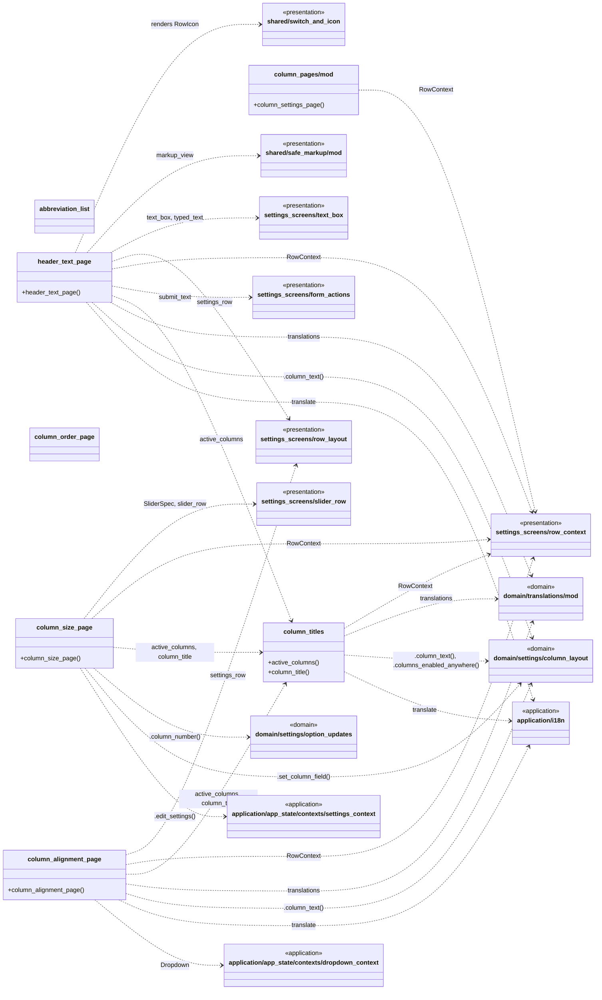

#### `settings_screens/column_pages/abbreviation_list`  (33 lines)

Saved action abbreviations with a remove button each.

*(declares modules only)*

#### `settings_screens/column_pages/column_alignment_page`  (35 lines)

Left / center / right alignment of each column's header and body.

| Item | Kind | What it does | Produces | Calls / uses |
|---|---|---|---|---|
| `column_alignment_page` | function | Left / center / right for each column's header and body. | DOM (Dioxus `Element`) | `settings_screens/column_pages/column_titles`: `active_columns`, `column_title`; `settings_screens/row_context`: `RowContext`; `settings_screens/row_layout`: `settings_row`; `application/app_state/contexts/dropdown_context`: `Dropdown`; `application/i18n`: `translate`; `domain/translations/mod`: `translations`; `domain/settings/column_layout`: `.column_text()` |

#### `settings_screens/column_pages/column_order_page`  (41 lines)

Column order page: up / down buttons per column.

*(declares modules only)*

#### `settings_screens/column_pages/column_size_page`  (22 lines)

Width and margin of each column, as sliders.

| Item | Kind | What it does | Produces | Calls / uses |
|---|---|---|---|---|
| `column_size_page` | function | One slider per column for its width or margin. | DOM (Dioxus `Element`) | `settings_screens/column_pages/column_titles`: `active_columns`, `column_title`; `settings_screens/slider_row`: `SliderSpec`, `slider_row`; `settings_screens/row_context`: `RowContext`; `domain/settings/option_updates`: `.column_number()`; `application/app_state/contexts/settings_context`: `.edit_settings()`; `domain/settings/column_layout`: `.set_column_field()` |

#### `settings_screens/column_pages/column_titles`  (17 lines)

Helpers for the pages that list the active columns.

| Item | Kind | What it does | Produces | Calls / uses |
|---|---|---|---|---|
| `active_columns` | function | Columns that are switched on in at least one table. | `Vec<String>` | `settings_screens/row_context`: `RowContext`; `domain/settings/column_layout`: `.columns_enabled_anywhere()` |
| `column_title` | function | "Job ❙ description of the column" – title used on all four column pages. | `String` | `settings_screens/row_context`: `RowContext`; `application/i18n`: `translate`; `domain/translations/mod`: `translations`; `domain/settings/column_layout`: `.column_text()` |

#### `settings_screens/column_pages/header_text_page`  (71 lines)

Custom header titles for each column.

| Item | Kind | What it does | Produces | Calls / uses |
|---|---|---|---|---|
| `header_text_page` | function | Custom header titles: a note, then (current title + text box) per column. | DOM (Dioxus `Element`) | **renders** `RowIcon`; `settings_screens/column_pages/column_titles`: `active_columns`; `settings_screens/form_actions`: `submit_text`; `settings_screens/text_box`: `text_box`, `typed_text`; `settings_screens/row_context`: `RowContext`; `settings_screens/row_layout`: `settings_row`; `application/i18n`: `translate`; `domain/translations/mod`: `translations`; … (+3) |

#### `settings_screens/column_pages/mod`  (33 lines)

Settings pages that are built from the current settings rather than from `l.json`: column order, column width / margin / alignment / header text, and the abbreviation list.

| Item | Kind | What it does | Produces | Calls / uses |
|---|---|---|---|---|
| `column_settings_page` | function | The width / margin / alignment / header-text tabs of the "cells" page. | DOM (Dioxus `Element`) | `settings_screens/row_context`: `RowContext` |

### 6.9 `settings_screens/schema_rows`

One builder per kind of entry in `l.json`: pick-one, switch, link, action, colour, slider, text, file.

```mermaid
classDiagram
  direction LR
  class settings_screens_schema_rows_choice_rows["choice_rows"]
  settings_screens_schema_rows_choice_rows : +radio_row()
  settings_screens_schema_rows_choice_rows : +switch_row()
  settings_screens_schema_rows_choice_rows : +column_switch_row()
  class settings_screens_schema_rows_link_and_action_rows["link_and_action_rows"]
  settings_screens_schema_rows_link_and_action_rows : +link_row()
  settings_screens_schema_rows_link_and_action_rows : +action_row()
  settings_screens_schema_rows_link_and_action_rows : +run_action()
  class settings_screens_schema_rows_mod["schema_rows/mod"]
  settings_screens_schema_rows_mod : +title()
  settings_screens_schema_rows_mod : +icon()
  settings_screens_schema_rows_mod : +note()
  settings_screens_schema_rows_mod : +render_schema_row()
  class settings_screens_schema_rows_text_rows["text_rows"]
  settings_screens_schema_rows_text_rows : +share_row()
  settings_screens_schema_rows_text_rows : +text_row()
  settings_screens_schema_rows_text_rows : +add_button_row()
  settings_screens_schema_rows_text_rows : +file_row()
  class settings_screens_schema_rows_value_rows["value_rows"]
  settings_screens_schema_rows_value_rows : +color_row()
  settings_screens_schema_rows_value_rows : +slider_setting_row()
  settings_screens_schema_rows_value_rows : +value_row()
  settings_screens_schema_rows_value_rows : +info_row()
  class x_application_app_state_contexts_dropdown_context["application/app_state/contexts/dropdown_context"]
  <<application>> x_application_app_state_contexts_dropdown_context
  class x_application_app_state_contexts_settings_context["application/app_state/contexts/settings_context"]
  <<application>> x_application_app_state_contexts_settings_context
  class x_application_i18n["application/i18n"]
  <<application>> x_application_i18n
  class x_domain_settings_column_layout["domain/settings/column_layout"]
  <<domain>> x_domain_settings_column_layout
  class x_domain_settings_option_access["domain/settings/option_access"]
  <<domain>> x_domain_settings_option_access
  class x_domain_settings_option_updates["domain/settings/option_updates"]
  <<domain>> x_domain_settings_option_updates
  class x_settings_screens_page_content["settings_screens/page_content"]
  <<presentation>> x_settings_screens_page_content
  class x_settings_screens_row_context["settings_screens/row_context"]
  <<presentation>> x_settings_screens_row_context
  class x_settings_screens_row_layout["settings_screens/row_layout"]
  <<presentation>> x_settings_screens_row_layout
  class x_shared_option_choice["shared/option_choice"]
  <<presentation>> x_shared_option_choice
  class x_shared_switch_and_icon["shared/switch_and_icon"]
  <<presentation>> x_shared_switch_and_icon
  class x_application_app_state_app_actions["application/app_state/app_actions"]
  <<application>> x_application_app_state_app_actions
  class x_application_app_state_screen_navigation["application/app_state/screen_navigation"]
  <<application>> x_application_app_state_screen_navigation
  class x_application_app_state_settings_maintenance["application/app_state/settings_maintenance"]
  <<application>> x_application_app_state_settings_maintenance
  class x_domain_settings_shareable_code["domain/settings/shareable_code"]
  <<domain>> x_domain_settings_shareable_code
  class x_settings_screens_form_actions["settings_screens/form_actions"]
  <<presentation>> x_settings_screens_form_actions
  class x_settings_screens_text_box["settings_screens/text_box"]
  <<presentation>> x_settings_screens_text_box
  class x_shared_safe_markup_mod["shared/safe_markup/mod"]
  <<presentation>> x_shared_safe_markup_mod
  class x_domain_settings_settings_file["domain/settings/settings_file"]
  <<domain>> x_domain_settings_settings_file
  class x_settings_screens_js_color["settings_screens/js_color"]
  <<presentation>> x_settings_screens_js_color
  class x_settings_screens_slider_row["settings_screens/slider_row"]
  <<presentation>> x_settings_screens_slider_row
  settings_screens_schema_rows_choice_rows ..> x_application_app_state_contexts_dropdown_context : Dropdown
  settings_screens_schema_rows_choice_rows ..> x_application_app_state_contexts_settings_context : .edit_settings()
  settings_screens_schema_rows_choice_rows ..> x_application_i18n : translate
  settings_screens_schema_rows_choice_rows ..> x_domain_settings_column_layout : .set_column_enabled()
  settings_screens_schema_rows_choice_rows ..> x_domain_settings_option_access : .option_enabled(), .option_value()
  settings_screens_schema_rows_choice_rows ..> x_domain_settings_option_updates : .column_number(), .set_option_enabled()
  settings_screens_schema_rows_choice_rows ..> x_settings_screens_page_content : SchemaEntry
  settings_screens_schema_rows_choice_rows ..> x_settings_screens_row_context : RowContext
  settings_screens_schema_rows_choice_rows ..> x_settings_screens_row_layout : settings_row
  settings_screens_schema_rows_choice_rows ..> settings_screens_schema_rows_mod : icon, note, title
  settings_screens_schema_rows_choice_rows ..> x_shared_option_choice : choice_key_of_value
  settings_screens_schema_rows_choice_rows ..> x_shared_switch_and_icon : renders SwitchToggle
  settings_screens_schema_rows_link_and_action_rows ..> x_application_app_state_app_actions : AppActions
  settings_screens_schema_rows_link_and_action_rows ..> x_application_app_state_contexts_dropdown_context : Dropdown, DropdownContext
  settings_screens_schema_rows_link_and_action_rows ..> x_application_app_state_screen_navigation : open_settings_page
  settings_screens_schema_rows_link_and_action_rows ..> x_application_app_state_settings_maintenance : back_up_settings, reset_settings_to_defaults, restore_settings_from_backup
  settings_screens_schema_rows_link_and_action_rows ..> x_application_i18n : message, translate
  settings_screens_schema_rows_link_and_action_rows ..> x_domain_settings_option_access : .option_enabled(), .option_text()
  settings_screens_schema_rows_link_and_action_rows ..> x_settings_screens_page_content : SchemaEntry
  settings_screens_schema_rows_link_and_action_rows ..> x_settings_screens_row_context : RowContext
  settings_screens_schema_rows_link_and_action_rows ..> x_settings_screens_row_layout : settings_row, settings_row_with_icon_cell
  settings_screens_schema_rows_link_and_action_rows ..> settings_screens_schema_rows_mod : icon, note, title
  settings_screens_schema_rows_mod ..> x_application_i18n : translate
  settings_screens_schema_rows_mod ..> x_settings_screens_page_content : SchemaEntry
  settings_screens_schema_rows_mod ..> x_settings_screens_row_context : RowContext
  settings_screens_schema_rows_text_rows ..> x_domain_settings_shareable_code : .export_shareable_code()
  settings_screens_schema_rows_text_rows ..> x_settings_screens_form_actions : add_abbreviation, set_background, submit_text
  settings_screens_schema_rows_text_rows ..> x_settings_screens_page_content : SchemaEntry
  settings_screens_schema_rows_text_rows ..> x_settings_screens_row_context : RowContext
  settings_screens_schema_rows_text_rows ..> settings_screens_schema_rows_mod : icon, note, title
  settings_screens_schema_rows_text_rows ..> x_settings_screens_text_box : text_box, typed_text
  settings_screens_schema_rows_text_rows ..> x_shared_safe_markup_mod : markup_view
  settings_screens_schema_rows_value_rows ..> x_application_app_state_contexts_settings_context : .edit_settings()
  settings_screens_schema_rows_value_rows ..> x_domain_settings_option_access : .color_hex(), .option_text(), .slider_value()
  settings_screens_schema_rows_value_rows ..> x_domain_settings_option_updates : .set_slider_value()
  settings_screens_schema_rows_value_rows ..> x_domain_settings_settings_file : .as_f64()
  settings_screens_schema_rows_value_rows ..> x_settings_screens_js_color : renders JsColorInput
  settings_screens_schema_rows_value_rows ..> x_settings_screens_page_content : SchemaEntry
  settings_screens_schema_rows_value_rows ..> x_settings_screens_row_context : RowContext
  settings_screens_schema_rows_value_rows ..> x_settings_screens_row_layout : settings_row
  settings_screens_schema_rows_value_rows ..> settings_screens_schema_rows_mod : icon, note, title
  settings_screens_schema_rows_value_rows ..> x_settings_screens_slider_row : SliderSpec, slider_row
```

#### `settings_screens/schema_rows/choice_rows`  (63 lines)

Pick-one rows and on/off switches.

| Item | Kind | What it does | Produces | Calls / uses |
|---|---|---|---|---|
| `radio_row` | function | "Pick one of several": shows the current choice, opens a radio dropdown on click. | DOM (Dioxus `Element`) | `settings_screens/schema_rows/mod`: `icon`, `title`; `settings_screens/row_context`: `RowContext`; `settings_screens/row_layout`: `settings_row`; `application/app_state/contexts/dropdown_context`: `Dropdown`; `application/i18n`: `translate`; `shared/option_choice`: `choice_key_of_value`; `settings_screens/page_content`: `SchemaEntry`; … (+1) |
| `switch_row` | function | On/off setting. | DOM (Dioxus `Element`) | **renders** `SwitchToggle`; `settings_screens/schema_rows/mod`: `icon`, `note`, `title`; `settings_screens/row_context`: `RowContext`; `settings_screens/row_layout`: `settings_row`; `shared/switch_and_icon`: `SwitchToggle`; `settings_screens/page_content`: `SchemaEntry`; `domain/settings/option_access`: `.option_enabled()`; `application/app_state/contexts/settings_context`: `.edit_settings()`; … (+1) |
| `column_switch_row` | function | On/off for a table column (in the DPS or HPS table). | DOM (Dioxus `Element`) | **renders** `SwitchToggle`; `settings_screens/schema_rows/mod`: `note`; `settings_screens/row_context`: `RowContext`; `settings_screens/row_layout`: `settings_row`; `shared/switch_and_icon`: `SwitchToggle`; `settings_screens/page_content`: `SchemaEntry`; `domain/settings/option_updates`: `.column_number()`; `application/app_state/contexts/settings_context`: `.edit_settings()`; … (+1) |

#### `settings_screens/schema_rows/link_and_action_rows`  (64 lines)

Rows that open pages or run actions.

| Item | Kind | What it does | Produces | Calls / uses |
|---|---|---|---|---|
| `link_row` | function | Opens another settings page (the entry id is the page name). | DOM (Dioxus `Element`) | `settings_screens/schema_rows/mod`: `icon`, `title`; `settings_screens/row_context`: `RowContext`; `settings_screens/row_layout`: `settings_row_with_icon_cell`; `application/app_state/screen_navigation`: `open_settings_page`; `settings_screens/page_content`: `SchemaEntry` |
| `action_row` | function | Reset / refresh / backup / restore, job filters, and plain info lines. | DOM (Dioxus `Element`) | `settings_screens/schema_rows/mod`: `icon`, `note`, `title`; `settings_screens/row_context`: `RowContext`; `settings_screens/row_layout`: `settings_row`; `application/i18n`: `message`, `translate`; `settings_screens/page_content`: `SchemaEntry`; `domain/settings/option_access`: `.option_enabled()`, `.option_text()` |
| `run_action` | function |  | side effect (signals / DOM events) | `application/app_state/app_actions`: `AppActions`; `application/app_state/contexts/dropdown_context`: `Dropdown`, `DropdownContext`; `application/app_state/settings_maintenance`: `back_up_settings`, `reset_settings_to_defaults`, `restore_settings_from_backup`; `application/i18n`: `translate` |

#### `settings_screens/schema_rows/mod`  (58 lines)

One schema entry -> one row.

| Item | Kind | What it does | Produces | Calls / uses |
|---|---|---|---|---|
| `title` | function |  | `String` | `settings_screens/page_content`: `SchemaEntry`; `application/i18n`: `translate` |
| `icon` | function |  | `String` | `settings_screens/page_content`: `SchemaEntry` |
| `note` | function | The grey explanation text (`m`) in the current language. | `String` | `settings_screens/page_content`: `SchemaEntry`; `application/i18n`: `translate` |
| `render_schema_row` | function |  | DOM (Dioxus `Element`) | `settings_screens/page_content`: `SchemaEntry`; `settings_screens/row_context`: `RowContext` |

#### `settings_screens/schema_rows/text_rows`  (117 lines)

Text boxes, the share code, the abbreviation add button and the background upload.

| Item | Kind | What it does | Produces | Calls / uses |
|---|---|---|---|---|
| `share_row` | function | Read-only box with the code others can paste into "Apply". | DOM (Dioxus `Element`) | `settings_screens/schema_rows/mod`: `icon`; `settings_screens/row_context`: `RowContext`; `settings_screens/page_content`: `SchemaEntry`; `domain/settings/shareable_code`: `.export_shareable_code()` |
| `text_row` | function | Text box, optionally with a send button. | DOM (Dioxus `Element`) | `settings_screens/schema_rows/mod`: `icon`, `note`; `settings_screens/form_actions`: `add_abbreviation`, `submit_text`; `settings_screens/text_box`: `text_box`, `typed_text`; `settings_screens/row_context`: `RowContext`; `settings_screens/page_content`: `SchemaEntry` |
| `add_button_row` | function | "Add to list" button of the abbreviation form. | DOM (Dioxus `Element`) | `settings_screens/schema_rows/mod`: `title`; `settings_screens/form_actions`: `add_abbreviation`; `settings_screens/row_context`: `RowContext`; `shared/safe_markup/mod`: `markup_view`; `settings_screens/page_content`: `SchemaEntry` |
| `file_row` | function | Background image upload: a hidden file input and a button that opens it, like the original's `li_file` (the full-width `<button>` look comes from the stylesheet, not from a label). | DOM (Dioxus `Element`) | `settings_screens/schema_rows/mod`: `title`; `settings_screens/form_actions`: `set_background`; `settings_screens/row_context`: `RowContext`; `settings_screens/page_content`: `SchemaEntry` |

#### `settings_screens/schema_rows/value_rows`  (45 lines)

Rows showing or editing a value: colour, slider, current value, information.

| Item | Kind | What it does | Produces | Calls / uses |
|---|---|---|---|---|
| `color_row` | function | Colour: a hex box tinted with its colour that opens the picker panel (the original's `jscolor`). | DOM (Dioxus `Element`) | **renders** `JsColorInput`; `settings_screens/schema_rows/mod`: `icon`, `title`; `settings_screens/row_context`: `RowContext`; `settings_screens/row_layout`: `settings_row`; `settings_screens/js_color`: `JsColorInput`; `settings_screens/page_content`: `SchemaEntry`; `domain/settings/option_access`: `.color_hex()` |
| `slider_setting_row` | function | Numeric setting stored in `Range`. | DOM (Dioxus `Element`) | `settings_screens/schema_rows/mod`: `icon`, `title`; `settings_screens/slider_row`: `SliderSpec`, `slider_row`; `settings_screens/row_context`: `RowContext`; `settings_screens/page_content`: `SchemaEntry`; `domain/settings/settings_file`: `.as_f64()`; `domain/settings/option_access`: `.slider_value()`; `application/app_state/contexts/settings_context`: `.edit_settings()`; … (+1) |
| `value_row` | function | Title plus a current value (fonts) or a hint (share / apply). | DOM (Dioxus `Element`) | `settings_screens/schema_rows/mod`: `note`, `title`; `settings_screens/row_context`: `RowContext`; `settings_screens/row_layout`: `settings_row`; `settings_screens/page_content`: `SchemaEntry`; `domain/settings/option_access`: `.option_text()` |
| `info_row` | function |  | DOM (Dioxus `Element`) | `settings_screens/schema_rows/mod`: `icon`, `note`, `title`; `settings_screens/row_layout`: `settings_row`; `settings_screens/page_content`: `SchemaEntry` |

### 6.10 `shared`

Small pieces used by several screens: typed styling values, safe markup, palette, ids, icons.

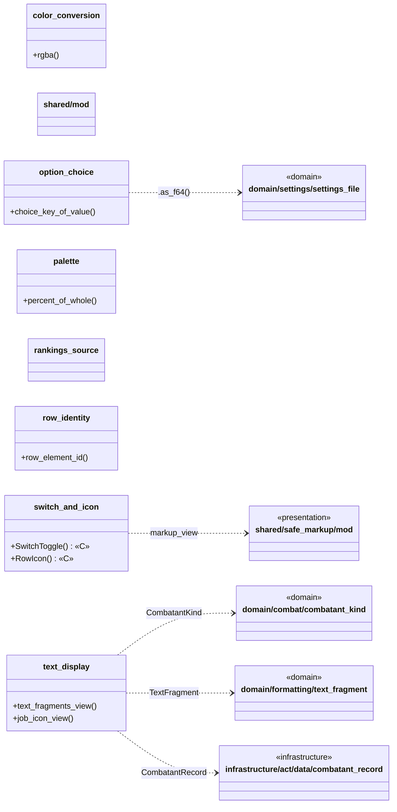

#### `shared/color_conversion`  (24 lines)

Hex colours ("03A9F4") to CSS `rgba(...)`.

| Item | Kind | What it does | Produces | Calls / uses |
|---|---|---|---|---|
| `hex_to_rgb` *(private)* | function | Red, green, blue of a hex colour. | `[u32; 3]` | — |
| `rgba` | function | `rgba(r,g,b,opacity)` for a hex colour and an opacity between 0 and 1. | `String` | — |

#### `shared/mod`  (22 lines)

Small pieces used by several screens.

*(declares modules only)*

#### `shared/option_choice`  (19 lines)

Settings values written as the keys of a choice list (`1`, `.`, `solid`).

| Item | Kind | What it does | Produces | Calls / uses |
|---|---|---|---|---|
| `choice_key_of_value` | function | The text a value has as an object key in the schema: numbers without a trailing `.0`, booleans as `1` / `0`. | `String` | `domain/settings/settings_file`: `.as_f64()` |

#### `shared/palette`  (11 lines)

Helpers for the graph bars.

| Item | Kind | What it does | Produces | Calls / uses |
|---|---|---|---|---|
| `percent_of_whole` | function | `part` as a whole percentage of `whole`, limited to 0-100. | `i32` | — |

#### `shared/rankings_source`  (16 lines)

Which rankings a table draws (live, or the sample in the settings preview).

*(declares modules only)*

#### `shared/row_identity`  (12 lines)

Element ids of table rows.

| Item | Kind | What it does | Produces | Calls / uses |
|---|---|---|---|---|
| `row_element_id` | function | "Eos (Some One)" -> "Eos_SomeOne"-like id: spaces and the first parentheses removed, apostrophes replaced (same rule as the original overlay). | `String` | — |

#### `shared/switch_and_icon`  (27 lines)

The on/off switch and row icons.

| Item | Kind | What it does | Produces | Calls / uses |
|---|---|---|---|---|
| `SwitchToggle` «C» | component | The sliding on/off switch drawn at the right of a row or menu item. | DOM (Dioxus `Element`) | — |
| `RowIcon` «C» | component | A Material icon by name, or an inline `` when the schema gives HTML (job icons on the colour pages). | DOM (Dioxus `Element`) | `shared/safe_markup/mod`: `markup_view` |

#### `shared/text_display`  (55 lines)

Cell text and job icons as DOM.

| Item | Kind | What it does | Produces | Calls / uses |
|---|---|---|---|---|
| `text_fragments_view` | function | Fragments as DOM: plain text, and dimmed text in a `span.ex`. | DOM (Dioxus `Element`) | `domain/formatting/text_fragment`: `TextFragment` |
| `icon_code` *(private)* | function | The icon file to show for a job code: its own when there is one, Limit Break's (`LMB`) for anything else (a job that ACT sends that the overlay has no icon for, an empty one, ...) rather than a broken image. | `&str` | — |
| `job_icon_view` | function | Job icon image for a player (`images/icon/<icon set>/<JOB TEXT>.png`). | DOM (Dioxus `Element`) | `domain/combat/combatant_kind`: `CombatantKind`; `infrastructure/act/data/combatant_record`: `CombatantRecord` |

### 6.11 `shared/safe_markup`

Turns the small HTML fragments of the translation files into Dioxus elements without ever giving the text to the browser as HTML.

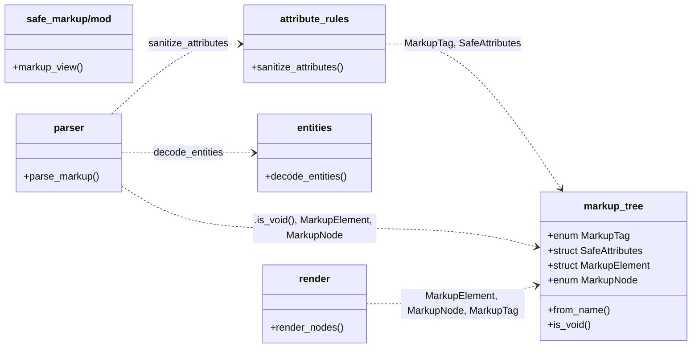

#### `shared/safe_markup/attribute_rules`  (55 lines)

Which attributes are allowed, and what their values may contain.

| Item | Kind | What it does | Produces | Calls / uses |
|---|---|---|---|---|
| `sanitize_attributes` | function | Keeps the allowed attributes of `tag` from the raw `(name, value)` pairs. | `SafeAttributes` | `shared/safe_markup/markup_tree`: `MarkupTag`, `SafeAttributes` |
| `is_identifier_list` *(private)* | function | Class and name values: letters, digits, `_`, `-` and spaces between class names. | `bool` | — |
| `parse_text_color` *(private)* | function | `color:#ffea00` or `color:cyan` (optionally with spaces and a trailing `;`). | `Option<String>` | — |
| `is_safe_link` *(private)* | function | Only in-page anchors and web links: never `javascript:`, `data:` or other schemes. | `bool` | — |
| `normalize_image_source` *(private)* | function | Images must come from the overlay's own `images/` folder. | `Option<String>` | — |

#### `shared/safe_markup/entities`  (48 lines)

Character references in text: `&amp;`, `&lt;`, `&#39;`, `&#x1F600;` ...

| Item | Kind | What it does | Produces | Calls / uses |
|---|---|---|---|---|
| `decode_entities` | function | Replaces the references a browser would have decoded. | `String` | — |
| `decode_reference` *(private)* | function | The character for the text between `&` and `;`. | `Option<char>` | — |

#### `shared/safe_markup/markup_tree`  (62 lines)

The parsed form of a markup fragment.

| Item | Kind | What it does | Produces | Calls / uses |
|---|---|---|---|---|
| `MarkupTag` | enum | Tags that may appear. | value type | — |
| `from_name` | method | The tag for a (case-insensitive) name, if it is on the allowlist. | `Option<MarkupTag>` | — |
| `is_void` | method | Tags that never have children or a closing tag. | `bool` | — |
| `SafeAttributes` | struct | Attributes that survived the allowlist. | value type | — |
| `MarkupElement` | struct |  | value type | — |
| `MarkupNode` | enum |  | value type | — |

#### `shared/safe_markup/mod`  (30 lines)

Safe rendering of the small HTML fragments that the translation files contain (`<b>`, ` `, ``, `<a href>`, `` ...).

| Item | Kind | What it does | Produces | Calls / uses |
|---|---|---|---|---|
| `markup_view` | function | Renders markup text as safe elements. | DOM (Dioxus `Element`) | — |

#### `shared/safe_markup/parser`  (190 lines)

Markup text -> `MarkupNode` tree, tolerant like a browser: bad nesting is repaired, unknown tags are shown as text, and nothing outside the allowlist is kept.

| Item | Kind | What it does | Produces | Calls / uses |
|---|---|---|---|---|
| `Tag` *(private)* | enum | One tag as written in the text. | value type | — |
| `OpenTag` *(private)* | enum |  | value type | `shared/safe_markup/markup_tree`: `MarkupTag` |
| `OpenElement` *(private)* | struct | An element whose closing tag has not been seen yet. | value type | `shared/safe_markup/markup_tree`: `MarkupNode`, `MarkupTag` |
| `parse_markup` | function |  | `Vec<MarkupNode>` | `shared/safe_markup/markup_tree`: `MarkupNode` |
| `TreeBuilder` *(private)* | struct |  | value type | `shared/safe_markup/markup_tree`: `MarkupNode` |
| `close_element` *(private)* | function |  | `MarkupNode` | `shared/safe_markup/attribute_rules`: `sanitize_attributes`; `shared/safe_markup/markup_tree`: `MarkupElement`, `MarkupNode` |
| `parse_tag` *(private)* | function | Reads one tag at the start of `text` (which begins with `<`). | `Option<(Tag, usize)>` | — |
| `tag_from_name` *(private)* | function |  | `Option<OpenTag>` | `shared/safe_markup/markup_tree`: `MarkupTag` |
| `find_tag_end` *(private)* | function | Byte index of the `>` that ends the tag, ignoring `>` inside quoted attribute values. | `Option<usize>` | — |
| `parse_attributes` *(private)* | function | `name="value" other='value' bare=value flag` -> pairs. | `Vec<(String, String)>` | `shared/safe_markup/entities`: `decode_entities` |

#### `shared/safe_markup/render`  (47 lines)

`MarkupNode`s -> Dioxus elements.

| Item | Kind | What it does | Produces | Calls / uses |
|---|---|---|---|---|
| `render_nodes` | function | The nodes have no identity of their own (they are the pieces of one piece of text, and the list is rebuilt whole whenever the text changes), so their position is the only key there is; that is the one case where an index is the r… | DOM (Dioxus `Element`) | `shared/safe_markup/markup_tree`: `MarkupNode` |
| `render_node` *(private)* | function |  | DOM (Dioxus `Element`) | `shared/safe_markup/markup_tree`: `MarkupNode` |
| `render_element` *(private)* | function |  | DOM (Dioxus `Element`) | `shared/safe_markup/markup_tree`: `MarkupElement`, `MarkupTag` |

### 6.12 `shared/style`

Typed styling values (`Size`, `Opacity`, `Paint`, `FontStack`, `Shadow`, `Vars`), shapes (`TextStyle`, `Line`, `Corners`) and the typed readers on `SettingsFile`.

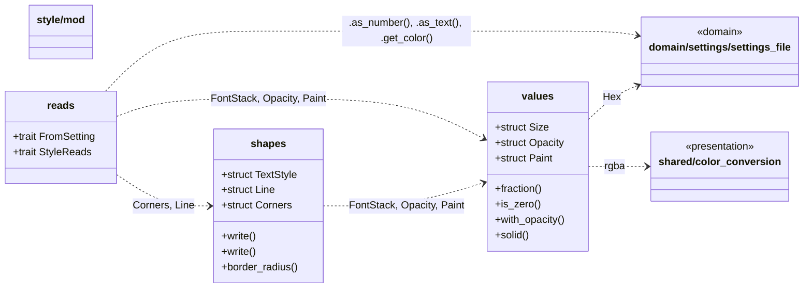

#### `shared/style/mod`  (25 lines)

Typed styling values: what the settings file says, in the units CSS needs.

*(declares modules only)*

#### `shared/style/reads`  (139 lines)

The typed readers on `SettingsFile`: one per convention of the file.

| Item | Kind | What it does | Produces | Calls / uses |
|---|---|---|---|---|
| `FromSetting` | trait | A choice in the file read as a type of its own: a number (`applyScope: 3`) or a name (`borderTextType: "outline"`). | trait | `domain/settings/settings_file`: `OptionValue` |
| `StyleReads` | trait |  | trait | `shared/style/shapes`: `Corners`, `Line`; `shared/style/values`: `FontStack`, `Opacity`, `Paint`; `domain/settings/settings_file`: `Hex` |

#### `shared/style/shapes`  (80 lines)

Shapes several areas have.

| Item | Kind | What it does | Produces | Calls / uses |
|---|---|---|---|---|
| `TextStyle` | struct | One themed text group (what `themed-text` in css/text.css shows): colour, opacity, the colour of the dimmed part (`.ex`), font, size, italic, bold and the text border. | value type | `shared/style/values`: `FontStack`, `Opacity`, `Paint` |
| `write` | method | Writes `--{prefix}-color`, `-opacity`, `-ex-color` and `-size` (when there are some), `-font`, `-style`, `-weight` and `-shadow`. | — | `shared/style/values`: `Vars` |
| `Line` | struct | A line: `border`-style `width style colour` (`0.1rem solid rgba(...)`). | value type | `shared/style/values`: `Paint`, `Size` |
| `Corners` | struct | The four corner radii of something: each corner's switch times the radius slider. | value type | `shared/style/values`: `Size` |
| `write` | method | Writes `--{prefix}-tl`, `-tr`, `-bl` and `-br`. | — | `shared/style/values`: `Vars` |
| `border_radius` | method | As the value of `border-radius` (clockwise from the top left). | `String` | — |

#### `shared/style/values`  (125 lines)

The value types.

| Item | Kind | What it does | Produces | Calls / uses |
|---|---|---|---|---|
| `Size` | struct | A size setting: tenths of a rem. | value type | — |
| `Opacity` | struct | An opacity setting: a percentage. | value type | — |
| `fraction` | method |  | `f64` | — |
| `is_zero` | method |  | `bool` | — |
| `Paint` | struct | A colour. | value type | `domain/settings/settings_file`: `Hex` |
| `with_opacity` | method |  | `Self` | `domain/settings/settings_file`: `Hex` |
| `solid` | method |  | `Self` | `domain/settings/settings_file`: `Hex` |
| `FontStack` | struct | A `font-family` list: the user's font first, then the original's fallbacks. | value type | — |
| `new` | method |  | `Self` | — |
| `Shadow` | enum | The `text-shadow` that gives text its border, in the "text border" colour: a soft glow, or an outline (four hard offsets). | value type | `domain/settings/settings_file`: `Hex` |
| `Vars` | struct | Builds the `--name:value;` declarations of an inline `style`, in the order they are set. | value type | — |
| `set` | method |  | `&mut Self` | — |
| `finish` | method |  | `String` | — |

### 6.13 `start_screen`

What is shown before the first message from ACT.

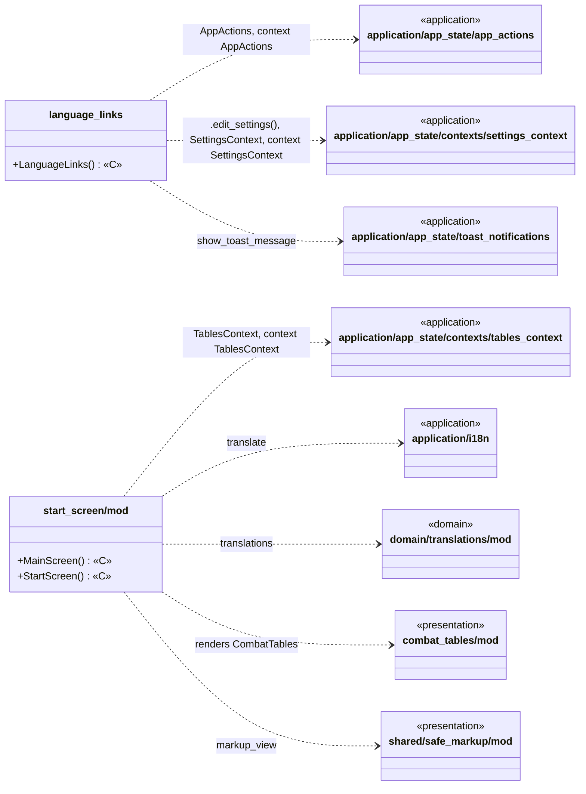

#### `start_screen/language_links`  (35 lines)

"Please select your language" links of the start screen.

| Item | Kind | What it does | Produces | Calls / uses |
|---|---|---|---|---|
| `LanguageLinks` «C» | component |  | DOM (Dioxus `Element`) | `application/app_state/toast_notifications`: `show_toast_message`; `application/app_state/app_actions`: `AppActions`; `application/app_state/contexts/settings_context`: `.edit_settings()`, `SettingsContext`; `application/app_state/app_actions`: context AppActions; `application/app_state/contexts/settings_context`: context SettingsContext |

#### `start_screen/mod`  (53 lines)

The main screen before any data arrived (start screen), and the switch to the tables.

| Item | Kind | What it does | Produces | Calls / uses |
|---|---|---|---|---|
| `MainScreen` «C» | component | The start screen until the first message, then the tables (hidden while standby is on). | DOM (Dioxus `Element`) | **renders** `CombatTables`; `combat_tables/mod`: `CombatTables`; `application/app_state/contexts/tables_context`: `TablesContext`; `application/app_state/contexts/tables_context`: context TablesContext |
| `StartScreen` «C» | component | The notice shown before any data arrives: introduction, language links, tips and update notes. | DOM (Dioxus `Element`) | **renders** `LanguageLinks`; `application/i18n`: `translate`; `domain/translations/mod`: `translations`; `shared/safe_markup/mod`: `markup_view` |

## Appendix — file index

| File | Lines | Package |
|---|---:|---|
| `presentation/mod` | 9 | (root) |
| `app_shell` | 145 | (root) |
| `areas/bars` | 172 | areas |
| `areas/columns` | 79 | areas |
| `areas/mod` | 57 | areas |
| `areas/nav` | 225 | areas |
| `areas/page` | 59 | areas |
| `areas/raid` | 84 | areas |
| `areas/table` | 245 | areas |
| `combat_tables/cell_classes` | 14 | combat_tables |
| `combat_tables/graph_bars` | 237 | combat_tables |
| `combat_tables/mod` | 100 | combat_tables |
| `combat_tables/raid_grid` | 74 | combat_tables |
| `combat_tables/standard_table` | 201 | combat_tables |
| `combat_tables/table_environment` | 87 | combat_tables |
| `combat_tables/visible_participants` | 42 | combat_tables |
| `dropdown_menus/choice_menus` | 51 | dropdown_menus |
| `dropdown_menus/menu_item` | 17 | dropdown_menus |
| `dropdown_menus/mod` | 33 | dropdown_menus |
| `dropdown_menus/navigation_menu` | 77 | dropdown_menus |
| `history_screen/history_row` | 47 | history_screen |
| `history_screen/mod` | 98 | history_screen |
| `mod` | 27 | (root) |
| `navigation_bar/buttons` | 146 | navigation_bar |
| `navigation_bar/mod` | 98 | navigation_bar |
| `navigation_bar/summary_line` | 83 | navigation_bar |
| `overlay_plugin_context` | 265 | (root) |
| `overlays` | 39 | (root) |
| `page_services` | 60 | (root) |
| `settings_screens/base64_encoding` | 20 | settings_screens |
| `settings_screens/column_pages/abbreviation_list` | 33 | settings_screens/column_pages |
| `settings_screens/column_pages/column_alignment_page` | 35 | settings_screens/column_pages |
| `settings_screens/column_pages/column_order_page` | 41 | settings_screens/column_pages |
| `settings_screens/column_pages/column_size_page` | 22 | settings_screens/column_pages |
| `settings_screens/column_pages/column_titles` | 17 | settings_screens/column_pages |
| `settings_screens/column_pages/header_text_page` | 71 | settings_screens/column_pages |
| `settings_screens/column_pages/mod` | 33 | settings_screens/column_pages |
| `settings_screens/form_actions` | 57 | settings_screens |
| `settings_screens/js_color` | 518 | settings_screens |
| `settings_screens/live_preview` | 34 | settings_screens |
| `settings_screens/mod` | 71 | settings_screens |
| `settings_screens/navigation_bar` | 52 | settings_screens |
| `settings_screens/page_content` | 78 | settings_screens |
| `settings_screens/row_context` | 22 | settings_screens |
| `settings_screens/row_groups` | 24 | settings_screens |
| `settings_screens/row_layout` | 46 | settings_screens |
| `settings_screens/schema_rows/choice_rows` | 63 | settings_screens/schema_rows |
| `settings_screens/schema_rows/link_and_action_rows` | 64 | settings_screens/schema_rows |
| `settings_screens/schema_rows/mod` | 58 | settings_screens/schema_rows |
| `settings_screens/schema_rows/text_rows` | 117 | settings_screens/schema_rows |
| `settings_screens/schema_rows/value_rows` | 45 | settings_screens/schema_rows |
| `settings_screens/slider_row` | 48 | settings_screens |
| `settings_screens/tab_bar` | 27 | settings_screens |
| `settings_screens/text_box` | 44 | settings_screens |
| `shared/color_conversion` | 24 | shared |
| `shared/mod` | 22 | shared |
| `shared/option_choice` | 19 | shared |
| `shared/palette` | 11 | shared |
| `shared/rankings_source` | 16 | shared |
| `shared/row_identity` | 12 | shared |
| `shared/safe_markup/attribute_rules` | 55 | shared/safe_markup |
| `shared/safe_markup/entities` | 48 | shared/safe_markup |
| `shared/safe_markup/markup_tree` | 62 | shared/safe_markup |
| `shared/safe_markup/mod` | 30 | shared/safe_markup |
| `shared/safe_markup/parser` | 190 | shared/safe_markup |
| `shared/safe_markup/render` | 47 | shared/safe_markup |
| `shared/style/mod` | 25 | shared/style |
| `shared/style/reads` | 139 | shared/style |
| `shared/style/shapes` | 80 | shared/style |
| `shared/style/values` | 125 | shared/style |
| `shared/switch_and_icon` | 27 | shared |
| `shared/text_display` | 55 | shared |
| `start_screen/language_links` | 35 | start_screen |
| `start_screen/mod` | 53 | start_screen |
